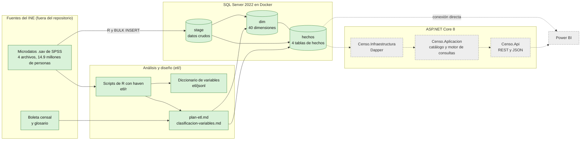
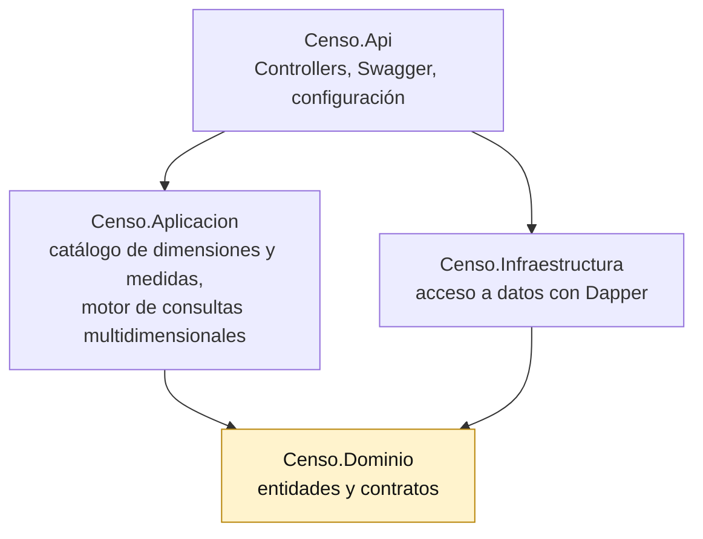
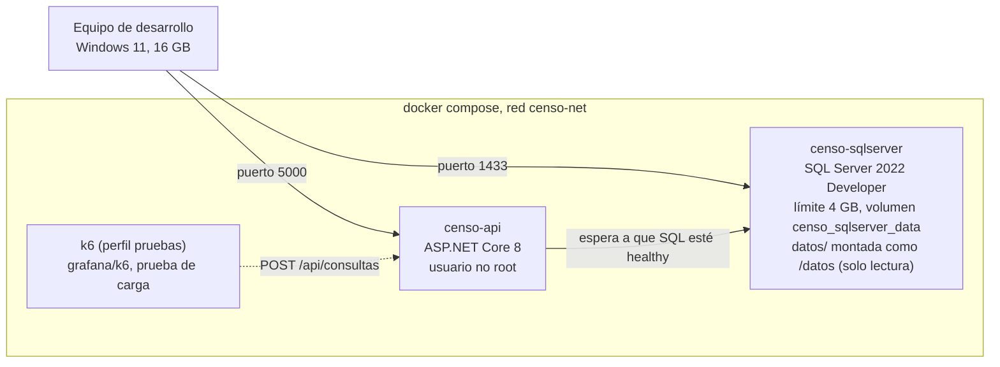
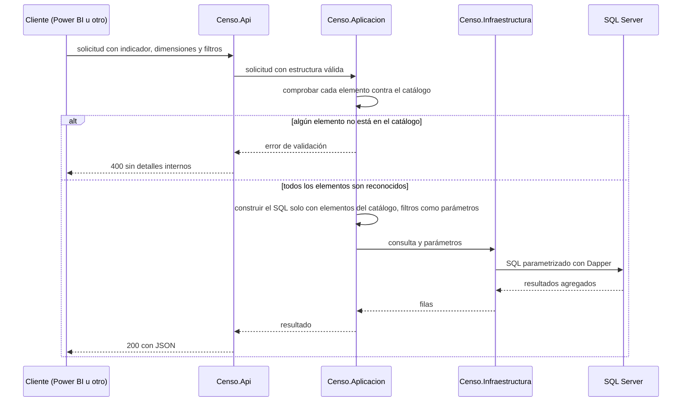

# Diagramas de arquitectura

> Actualizado: 2026-09-26. Los diagramas usan [Mermaid](https://mermaid.js.org/) y se visualizan en GitHub, en la vista previa de Markdown de VS Code (con la extensión *Markdown Preview Mermaid Support*) y en Visual Studio. Fundamento teórico: capítulo II de la tesis, secciones 2.4 a 2.8.

## 1. Visión general del sistema

Los nodos verdes ya existen (la base de datos está cargada con los datos del censo); los grises con borde punteado están pendientes.

## 2. Capas de la solución .NET

Las dependencias apuntan hacia el núcleo (`Censo.Dominio`), que no depende de ninguna otra capa (arquitectura por capas con inversión de dependencias, tesis 2.4.1 y 2.4.6).

Estado: implementadas. `Censo.Dominio` define los registros del catálogo, los modelos de consulta y los contratos (`ICatalogo`, `IRepositorioConsultas`); `Censo.Aplicacion` contiene el catálogo (`CatalogoCenso`), el validador, el constructor de SQL y el servicio de consultas; `Censo.Infraestructura` implementa el repositorio con Dapper; `Censo.Api` expone los controladores y compone las dependencias.

## 3. Despliegue local con Docker Compose

El servicio `k6` solo arranca con `docker compose --profile pruebas` (lo hace `pruebas/carga/ejecutar-carga.sh`); con `K6_BASE_URL` apunta a otro despliegue, por ejemplo Azure.

El destino previsto en la nube es Azure App Service para la API y Azure SQL Database para los datos (tesis 2.8.5).

## 4. Flujo de una consulta dinámica

Cuatro etapas de la tesis (2.4.5): recibir la solicitud, validarla contra el catálogo, construir la instrucción solo con elementos reconocidos y ejecutarla con parámetros. Implementado en `ServicioConsultas` (validación y construcción) y `RepositorioConsultasSql` (ejecución); los errores de la base de datos devuelven 500 o 504 con un mensaje genérico, sin detalles internos.

