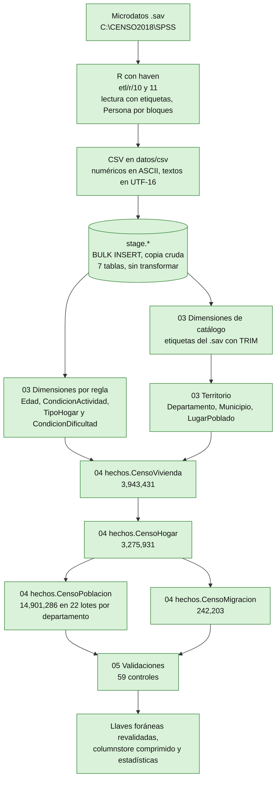
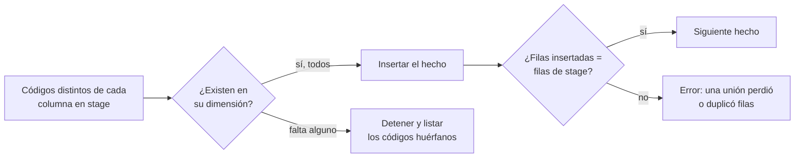

# Diagrama del flujo de ETL

> Actualizado: 2026-09-26. Flujo implementado y ejecutado: los datos del Censo 2018 están cargados en `CensoGT2018` y superan los 59 controles de `etl/sql/05-validaciones.sql`. Se ejecuta con `bash etl/ejecutar-etl.sh` y tarda unos 31 minutos desde los `.sav`. Detalle de cada paso y de los problemas resueltos: `etl/plan-etl.md`. Fundamento teórico: tesis 2.6.6 y 2.6.7.

## 1. Flujo

Los números `03`, `04` y `05` son los scripts de `etl/sql`. El orden respeta las dependencias: primero las dimensiones, luego los hechos de arriba hacia abajo en la jerarquía. Durante la carga de hechos se desactivan las llaves foráneas y al final se revalidan (`WITH CHECK CHECK CONSTRAINT ALL`), de modo que las 76 quedan de confianza. La base pasa a recuperación `SIMPLE` para minimizar el registro de transacciones.

## 2. Controles previos a la inserción

Antes de cargar los hechos, `04-cargar-hechos.sql` comprueba que todo código presente en `stage` exista en su dimensión y se detiene, listando los códigos huérfanos, si falta alguno. Así un código sin etiqueta en el origen no se convierte en `NULL` en silencio: este control detectó la rama de actividad 54 (una persona) y obligó a decidir cómo tratarla.

## 3. Reglas de transformación

| Regla | Aplica a |
|---|---|
| Quitar espacios iniciales y finales de las etiquetas (`TRIM`) | Todos los catálogos (por ejemplo `" Cobán"`) |
| "No aplica" (salto del cuestionario) se guarda como `NULL` | Llaves foráneas y columnas que admiten nulo |
| "No declarado" es un miembro de la dimensión | Códigos 9 de los catálogos, incluidos `PCP9` y `PCP14` (`Dim.RespuestaSiNo`) |
| Códigos centinela `99` y `9999` se guardan como `NULL` | `AnioLlegadaPais`, `AnioSalida`, `HijosNacidosVivos*`, `EdadPrimerHijo`, `DiaUltimoHijo`, `MesUltimoHijo`, `AnioUltimoHijo` |
| Preguntas Sí/No: 1 pasa a 1 y 2 pasa a 0 | Columnas `BIT` (`PCH9_A` a `PCH9_M`, `PCH13`, `PCH15`, `PEI1`, `PCP18`, `PCP22`, `PCP24`, `PCP27`, `PCP39`) |
| `AREA` = 1 (urbano) pasa a `EsUrbano` = 1 | `hechos.CensoVivienda` |
| `MIGRA_VIDA` = 2 y `MIGRA_REC` = 2 significan migrante | `EsMigranteVida`, `EsMigranteReciente` |
| `CondicionActividadId` se deriva de `PEA`, `POCUPA`, `PDESOC` y `PEI`; menores de 7 años quedan sin valor | `hechos.CensoPoblacion` |
| `CondicionDificultadId` se deriva de las 6 preguntas de dificultad (`PCP16_A` a `PCP16_F`) como en el cuadro A8; menores de 4 años quedan sin valor | `hechos.CensoPoblacion` |
| `TipoHogarId` se deriva del parentesco (`PCP5`) de los miembros de cada hogar como en el cuadro B8 (tabla temporal `#TipologiaHogar` antes de cargar el hogar) | `hechos.CensoHogar` |
| El territorio de vivienda se copia a hogar, persona y emigrante | `LugarPobladoId` |
| Cada código de 2 dígitos se asigna a su grupo de 1 dígito más frecuente (el origen no es estrictamente jerárquico: 2 códigos de ocupación y 5 de rama tienen 2 grupos) | `Dim.Ocupacion`, `Dim.RamaActividad` |
| Los códigos presentes en los datos y sin etiqueta en el `.sav` se agregan con un nombre explícito | Rama de actividad 54 |
| Los códigos del INE se traducen a la llave sustituta con la restricción única de cada dimensión | Todas las llaves foráneas |

## 4. Controles de validación (`etl/sql/05-validaciones.sql`)

Cada control compara un valor esperado, obtenido de forma independiente, con el resultado en la base. La carga completa pasó **59 de 59** (recarga del 2026-09-26 con las clasificaciones derivadas; la primera corrida tenía 50 controles).

| Grupo | Controles | Ejemplos |
|---|---|---|
| Filas | 12 | Vivienda 3,943,431; Hogar 3,275,931; Población 14,901,286; Migración 242,203; 22 departamentos, 362 municipios, 20,254 lugares poblados |
| Integridad | 10 | 78 llaves foráneas de confianza; 43,752 personas sin hogar (42,536 en vivienda colectiva y 1,216 sin vivienda); 763,836 viviendas sin hogar; `TotalPersonas` igual al conteo de personas de cada hogar |
| Diccionario | 13 | 2,213,460 viviendas urbanas; 6,207,503 personas mayas; 4,062,290 personas que asisten a un establecimiento; 2,598,582 migrantes de toda la vida |
| Actividad | 6 | 4,968,542 ocupadas; 53,516 y 87,952 desocupadas; 7,249,485 inactivas; 169,442 no declaradas |
| Transformación y texto | 9 | Ningún `99` ni `9999` restante; 241,578 y 371,419 personas con código 9 en `PCP9` y `PCP14`; acentos correctos; 4 nombres de lugares poblados con defectos que ya vienen en el `.sav` |
| Pendiente | 1 | Totales frente a los 25 cuadros oficiales del INE (prueba de exactitud, objetivo específico 4) |

## 5. Tiempos de la carga completa

| Etapa | Duración aproximada |
|---|---|
| Exportación desde los `.sav` (R) | 3 min 47 s |
| Vaciado del modelo (solo al recargar) | 2 min 56 s |
| Creación de `stage` y carga de los CSV (Persona, 6 min) | 7 min 16 s |
| Dimensiones | 1 s |
| Hechos (Vivienda 44 s, Hogar 100 s, Migración 4 s, Población 10 min, más unos 5 min de revalidación, compresión y estadísticas) | 17 min 20 s |
| Validaciones | 4 s |
| **Total** | **31 min 24 s** |

Medido en la corrida completa de referencia (laptop de 16 GB, SQL Server con 2 CPU); la carga termina con los 59 controles de `etl/sql/05-validaciones.sql`.
