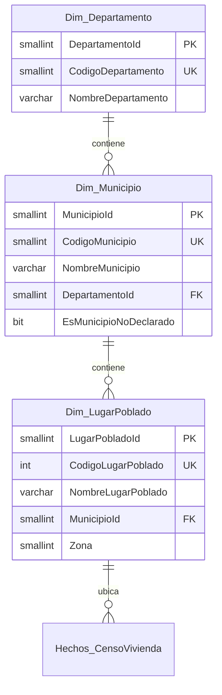
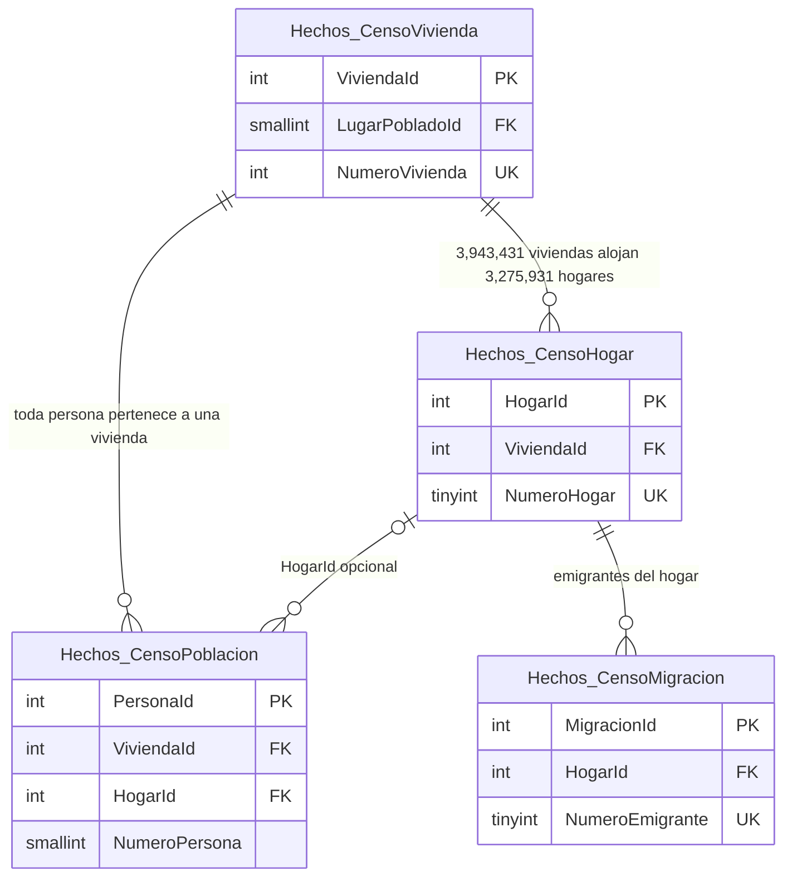
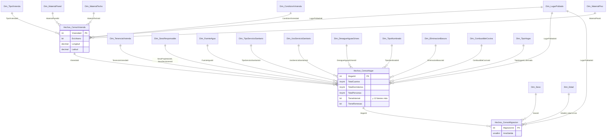
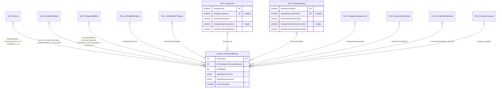

# Diagramas del modelo de datos

> Actualizado: 2026-09-26. Corresponde al esquema creado en `db/02-dimensiones` y `db/03-indices` (40 dimensiones, 4 tablas de hechos, 78 llaves foráneas; datos cargados y validados). Las entidades usan guion bajo en lugar del punto del esquema: `Dim_Sexo` es `dim.Sexo`. Detalle de cada columna y su variable de origen: `etl/clasificacion-variables.md` y los comentarios de los scripts SQL. Fundamento teórico: tesis 2.6.4 y 2.6.5.

## 1. Jerarquía territorial

`Departamento → Municipio → LugarPoblado`. `Dim_Municipio` incluye 22 miembros "*Departamento* municipio no declarado" (códigos 199, 299, …, 2299) además de los 340 municipios.

## 2. Jerarquía de las tablas de hechos

Una vivienda aloja uno o más hogares y un hogar agrupa personas y emigrantes. Las 43,752 personas que viven en vivienda colectiva o sin vivienda (0.29%) no tienen hogar: por eso `HogarId` es opcional en `Hechos_CensoPoblacion`. El 19.4% de las viviendas (763,836) no tiene hogar: 762,447 no están ocupadas (desocupadas, de uso temporal o con moradores ausentes, `PCV4` = 2, 3 o 4) y 1,389 son viviendas colectivas o "sin vivienda".

| Tabla | Grano | Filas |
|---|---|---|
| `hechos.CensoVivienda` | una vivienda | 3,943,431 |
| `hechos.CensoHogar` | un hogar | 3,275,931 |
| `hechos.CensoPoblacion` | una persona | 14,901,286 |
| `hechos.CensoMigracion` | un emigrante internacional | 242,203 |

## 3. Estrella de vivienda, hogar y migración

Cada hecho copia `LugarPobladoId` para consultar territorio sin unir tablas. `SexoResponsable` se usa dos veces en el hogar: `SexoPropietarioId` (`PCH2`) y `SexoDecisionesId` (`PCH3`). `Dim_TipoHogar` es derivada en el ETL del parentesco de los miembros (tipología del cuadro B8 del INE: unipersonal, nuclear, extendido, compuesto, co-residentes; el hijastro cuenta como otro pariente).

## 4. Estrella de población (parte 1: origen, cultura y educación)

`Hechos_CensoPoblacion` referencia cuatro veces a `Dim_Departamento`, `Dim_Municipio` y `Dim_Pais` (nacimiento, residencia en 2013, estudio y trabajo) y tres veces a `Dim_TipoLugar`. Esas dimensiones se dibujan una sola vez con la lista de roles.

```mermaid
erDiagram
    Dim_LugarPoblado ||--o{ Hechos_CensoPoblacion : "LugarPobladoId"
    Hechos_CensoVivienda ||--o{ Hechos_CensoPoblacion : "ViviendaId"
    Hechos_CensoHogar |o--o{ Hechos_CensoPoblacion : "HogarId opcional"
    Dim_Sexo ||--o{ Hechos_CensoPoblacion : "SexoId"
    Dim_Edad ||--o{ Hechos_CensoPoblacion : "EdadId"
    Dim_Parentesco ||--o{ Hechos_CensoPoblacion : "ParentescoId"
    Dim_Pueblo ||--o{ Hechos_CensoPoblacion : "PuebloId"
    Dim_ComunidadLinguistica |o--o{ Hechos_CensoPoblacion : "ComunidadLinguisticaId"
    Dim_TipoLugar ||--o{ Hechos_CensoPoblacion : "Nacimiento, Estudio, Trabajo"
    Dim_TipoResidencia2013 ||--o{ Hechos_CensoPoblacion : "TipoResidencia2013Id"
    Dim_Departamento |o--o{ Hechos_CensoPoblacion : "Nacimiento, Residencia2013, Estudio, Trabajo"
    Dim_Municipio |o--o{ Hechos_CensoPoblacion : "Nacimiento, Residencia2013, Estudio, Trabajo"
    Dim_Pais |o--o{ Hechos_CensoPoblacion : "Nacimiento, Residencia2013, Estudio, Trabajo"
    Dim_NivelGrado |o--o{ Hechos_CensoPoblacion : "NivelGradoId"
    Dim_TipoEstablecimiento |o--o{ Hechos_CensoPoblacion : "TipoEstablecimientoId"
    Dim_CausaNoAsistencia |o--o{ Hechos_CensoPoblacion : "CausaNoAsistenciaId"

    Dim_Edad {
        tinyint EdadId PK "edad en años, 0 a 124"
        varchar GrupoQuinquenal
        varchar GrupoAmplio
        bit EsEdadTrabajar
    }
    Dim_NivelGrado {
        smallint NivelGradoId PK
        smallint CodigoNivelEducativo
        varchar NombreNivelEducativo
    }
    Hechos_CensoPoblacion {
        int PersonaId PK
        int ViviendaId FK
        int HogarId FK "nulo en vivienda colectiva"
        smallint NumeroPersona
        tinyint AniosEstudio
        tinyint GradoMasAltoAprobado
        bit EsMigranteVida
        bit EsMigranteReciente
    }
```

## 5. Estrella de población (parte 2: idiomas, respuestas Sí/No, actividad económica y fecundidad)

`Dim_Ocupacion` y `Dim_RamaActividad` tienen grano de 2 dígitos y guardan el grupo de 1 dígito como atributo. `Dim_CondicionActividad` es derivada: 1 ocupada, 2 desocupada aspirante, 3 desocupada cesante, 4 inactiva, 5 no declarada; los menores de 7 años quedan sin valor. `Dim_CondicionDificultad` también es derivada, de las 6 preguntas de dificultad (cuadro A8): 1 sin dificultad, 2 con al menos una dificultad, 9 no declarado; los menores de 4 años quedan sin valor.

## 6. Dimensiones de rol de `Hechos.CensoPoblacion`

| Dimensión | Columnas de `CensoPoblacion` que la referencian |
|---|---|
| `Dim.TipoLugar` | `TipoLugarNacimientoId`, `TipoLugarEstudioId`, `TipoLugarTrabajoId` |
| `Dim.Departamento` | `DepartamentoNacimientoId`, `DepartamentoResidencia2013Id`, `DepartamentoEstudioId`, `DepartamentoTrabajoId` |
| `Dim.Municipio` | `MunicipioNacimientoId`, `MunicipioResidencia2013Id`, `MunicipioEstudioId`, `MunicipioTrabajoId` |
| `Dim.Pais` | `PaisNacimientoId`, `PaisResidencia2013Id`, `PaisEstudioId`, `PaisTrabajoId` |
| `Dim.Idioma` | `IdiomaMaternoId`, `IdiomaLecturaEscritura1Id` a `3Id`, `OtroIdioma1Id` a `3Id` |
| `Dim.GradoDificultad` | `DificultadVerId`, `DificultadOirId`, `DificultadCaminarId`, `DificultadRecordarId`, `DificultadCuidadoPersonalId`, `DificultadComunicarseId` |
| `Dim.RespuestaSiNo` | `InscripcionRenapId`, `UsoTrajeTradicionalId`, `UsoCelularId`, `UsoComputadoraId`, `UsoInternetId` (Sí, No y No declarado) |

## 7. Índices y restricciones (`db/03-indices`)

| Elemento | Cantidad | Detalle |
|---|---|---|
| Llaves foráneas | 78 | 53 en `CensoPoblacion`, 13 en `CensoHogar`, 6 en `CensoVivienda`, 4 en `CensoMigracion`, 2 en la jerarquía territorial |
| Restricciones únicas | 42 | El código del INE en cada dimensión (excepto `Dim.Edad`, cuya llave es la edad) y la llave natural de vivienda, hogar y emigrante |
| Columnstore agrupado | 3 | `CensoVivienda`, `CensoHogar` y `CensoPoblacion`; `CensoMigracion` (242,203 filas) queda como rowstore |
