# Manual técnico

**Sistema de consulta multidimensional del Censo de Población y Vivienda 2018 de Guatemala**

| | |
|---|---|
| Dirigido a | Administradores de bases de datos, desarrolladores de API y analistas de Power BI que quieran implementar el sistema desde cero, ponerlo en producción y mantenerlo |
| Alcance | Requisitos, obtención del código, instalación local, carga de datos, verificación, conexión de Power BI, puesta en producción en Azure, operación, mantenimiento y solución de problemas |
| Repositorio | `https://github.com/stmhida6/censo2018-consulta-multidimensional` |
| Licencia | MIT (código). Los microdatos y cuadros son del Instituto Nacional de Estadística (INE) de Guatemala |
| Manual de usuario | `docs/manual-usuario.md` |

Las rutas son relativas a la raíz del repositorio. Los comandos se ejecutan en **Bash**: Git Bash en Windows, o la terminal en Linux y macOS.

---

## 1. Arquitectura

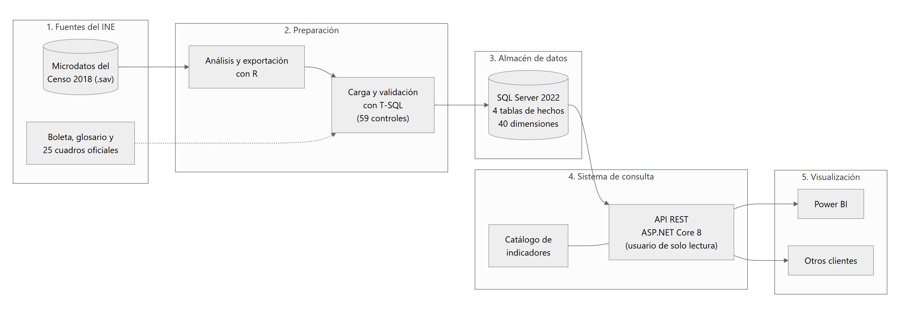

*Figura 1. Componentes y flujo de datos: microdatos del INE, ETL, almacén en estrella, API y clientes.*

| Capa | Tecnología | Carpeta | Responsabilidad |
|---|---|---|---|
| Origen | Microdatos del INE en SPSS (`.sav`) | `datos/microdatos/` (no se versiona) | Datos fuente |
| ETL | R (exportación a CSV) y T-SQL (`BULK INSERT`) | `etl/` | Llevar los microdatos al modelo con 59 controles |
| Almacén | SQL Server 2022 en Docker; esquema en estrella | `db/` | 40 dimensiones, 4 hechos, índices columnstore |
| Servicio | ASP.NET Core 8 Web API con Dapper | `src/` | Validar solicitudes, generar SQL parametrizado y calcular indicadores |
| Clientes | Power BI Desktop, Swagger y k6 | `powerbi/`, `pruebas/carga/` | Consumir la API |
| Producción | Azure SQL Database y Azure App Service | `despliegue/` | Publicación en la nube |

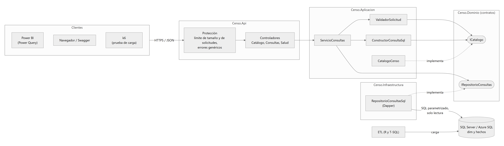

*Figura 2. Proyectos de la solución y sus dependencias.*

**Principio de diseño:** el catálogo (`src/Censo.Aplicacion/Catalogo/`) es la única fuente de lo que se puede consultar. El SQL se arma solo con fragmentos del catálogo y los valores de los filtros van siempre como parámetros. Los indicadores se calculan en C# como razón de agregados, nunca como promedio de tasas. Convenciones completas: `docs/convenciones.md`.

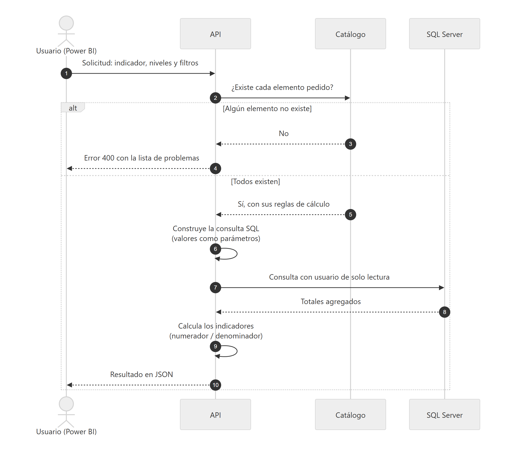

*Figura 3. Secuencia de una consulta válida y de una rechazada.*

---

## 2. Requisitos

### 2.1 Software

| Elemento | Versión probada | Para qué | Obligatorio |
|---|---|---|---|
| Git (en Windows, con Git Bash) | 2.x | Clonar el repositorio y ejecutar los scripts `.sh` | Sí |
| Docker Desktop (o Docker Engine con Compose) | Engine 29 | SQL Server, la API y k6 en contenedores | Sí |
| R con los paquetes `haven`, `data.table`, `dplyr` y `jsonlite` | 4.5.2 | Exportar los `.sav` a CSV (solo durante la carga) | Sí |
| .NET SDK | 8.0 o posterior | Ejecutar las pruebas y publicar la API | Sí |
| Python | 3.10 o posterior | Empaquetar la API para Azure y pruebas de consumo | Para producción |
| Azure CLI | 2.91 | Crear y operar los recursos en Azure | Para producción |
| SqlPackage | 170.5 (`dotnet tool install -g microsoft.sqlpackage`) | Migrar la base a Azure (BACPAC) | Para producción |
| Power BI Desktop | 2.157 | Tablero | Opcional |

Instalar los paquetes de R:

```bash
Rscript -e 'install.packages(c("haven", "data.table", "dplyr", "jsonlite"), repos = "https://cloud.r-project.org")'
```

### 2.2 Hardware

| Recurso | Mínimo recomendado | Detalle |
|---|---|---|
| Memoria | 16 GB | El contenedor de SQL Server usa 4 GB (3 GB internos) |
| Disco libre | 20 GB | Volumen de SQL Server 7.4 GB, CSV 2.5 GB, imágenes de Docker 4 GB, microdatos y BACPAC |
| Procesador | 4 núcleos | SQL Server está limitado a 2 CPU en el contenedor |

### 2.3 Datos y cuentas

| Elemento | Detalle |
|---|---|
| Microdatos del Censo 2018 | Publicados por el INE en el sitio oficial del censo (`https://censo2018.ine.gob.gt/`), página de descarga de bases de datos (`https://censo2018.ine.gob.gt/descarga`), en formato SPSS. Se necesitan los cuatro archivos con estos nombres exactos: `VIVIENDA_BDP.sav`, `HOGAR_BDP.sav`, `PERSONA - BDP.sav` y `MIGRACION_BDP.sav` |
| Cuenta de Azure | Solo para producción. La oferta gratuita de Azure SQL Database no está disponible con *Azure for Students Starter* ni en todas las regiones (se usó West US) |

---

## 3. Obtener el código

```bash
git clone https://github.com/stmhida6/censo2018-consulta-multidimensional.git
cd censo2018-consulta-multidimensional
```

```
src/          API: Censo.Api, Censo.Aplicacion (catálogo y motor), Censo.Dominio, Censo.Infraestructura (Dapper)
db/           Esquema de la base: 01-esquema, 02-dimensiones, 03-indices; crear-esquema.sh y crear-usuario-api.sh
etl/          Exportación con R (etl/r) y carga en T-SQL (etl/sql); ejecutar-etl.sh
pruebas/      Pruebas automáticas (BaseDatos, Aplicacion, Integracion) y prueba de carga con k6 (pruebas/carga)
validacion/   Los 25 cuadros oficiales del INE y su mapeo, usados por la prueba de exactitud
powerbi/      Consultas de Power Query, medidas DAX y guía del tablero
despliegue/   Scripts de producción en Azure (despliegue/scripts)
docs/         Manuales, convenciones, catálogo, diagramas y resultados de referencia
datos/        Microdatos, CSV, BACPAC y registros (se crea localmente; no se versiona)
```

---

## 4. Instalación local

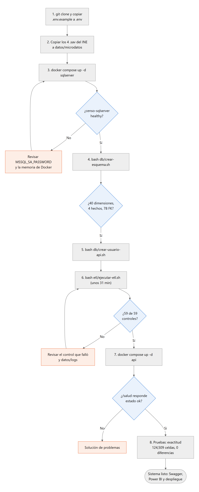

*Figura 4. Pasos de la instalación local y sus verificaciones.*

### 4.1 Configurar

```bash
cp .env.example .env
```

Editar `.env`; el archivo contiene secretos y no se versiona.

| Variable | Uso | Valor por defecto |
|---|---|---|
| `MSSQL_SA_PASSWORD` | Clave del administrador de SQL Server (8 caracteres o más, con mayúscula, minúscula, número y símbolo) | Obligatoria |
| `CLAVE_API` | Clave del usuario de solo lectura `CensoApi` (12 caracteres o más) | Obligatoria |
| `MICRODATOS_DIR` | Carpeta de los cuatro `.sav` | `datos/microdatos` |
| `RSCRIPT` | Ruta de `Rscript` si no está en el PATH | Se detecta sola |
| `SQLSERVER_PORT` / `API_HTTP_PORT` | Puertos expuestos | `1433` / `5000` |
| `DB_MEM_LIMIT`, `DB_MEMORY_LIMIT_MB`, `DB_CPU_LIMIT` | Recursos del contenedor de SQL Server | `4g`, `3072`, `2` |
| `ASPNETCORE_ENVIRONMENT` | `Development` habilita Swagger | `Development` |
| `API_LIMITE_POR_MINUTO` | Solicitudes por minuto y por IP | `120` |

### 4.2 Microdatos

Copiar los cuatro archivos `.sav` del INE a `datos/microdatos/` (o a la carpeta indicada en `MICRODATOS_DIR`):

```
datos/microdatos/VIVIENDA_BDP.sav
datos/microdatos/HOGAR_BDP.sav
datos/microdatos/PERSONA - BDP.sav
datos/microdatos/MIGRACION_BDP.sav
```

### 4.3 SQL Server y esquema

```bash
docker compose up -d sqlserver
docker ps --filter name=censo-sqlserver          # esperar "(healthy)", unos 30 s
bash db/crear-esquema.sh                         # base, esquemas, 40 dimensiones, 4 hechos, 78 llaves foráneas
bash db/crear-usuario-api.sh                     # usuario CensoApi de solo lectura
```

`crear-esquema.sh` ejecuta en orden `db/01-esquema`, `db/02-dimensiones` y `db/03-indices`, y al final muestra los conteos para compararlos con los esperados.

### 4.4 Carga de datos (ETL)

```bash
bash etl/ejecutar-etl.sh                         # unos 31 minutos
```

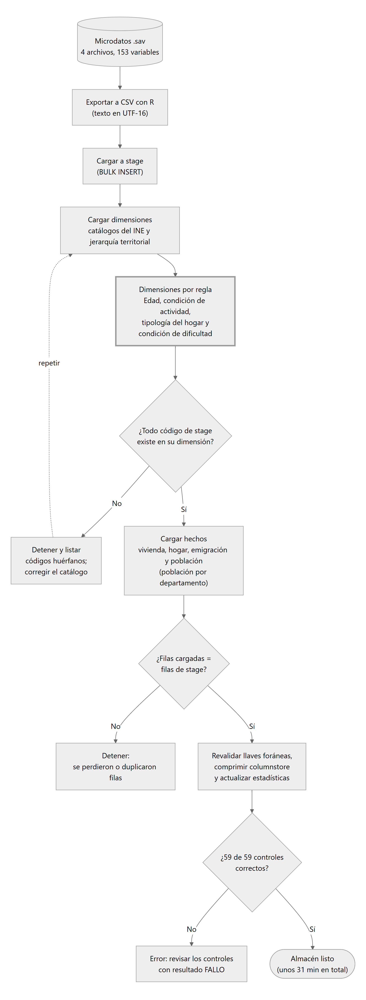

*Figura 5. Flujo del ETL con sus puntos de control.*

| Etapa | Qué hace | Tiempo de referencia |
|---|---|---|
| Exportación (R) | Lee los `.sav` y escribe CSV en `datos/csv` (UTF-16 los que tienen texto) | 4 min |
| `stage` | `BULK INSERT` de los CSV | 7 min |
| Dimensiones y hechos | Transformación dentro de SQL Server, con controles que detienen la carga ante inconsistencias; índices columnstore y estadísticas | 17 min |
| Validación | 59 controles contra cifras independientes | Segundos |

| Opción | Efecto |
|---|---|
| (sin opciones) | Exporta los CSV solo si faltan, carga y valida |
| `--recargar` | Vacía dimensiones y hechos y vuelve a cargar |
| `--exportar` | Vuelve a exportar los CSV desde los `.sav` |

Resultado esperado al final:

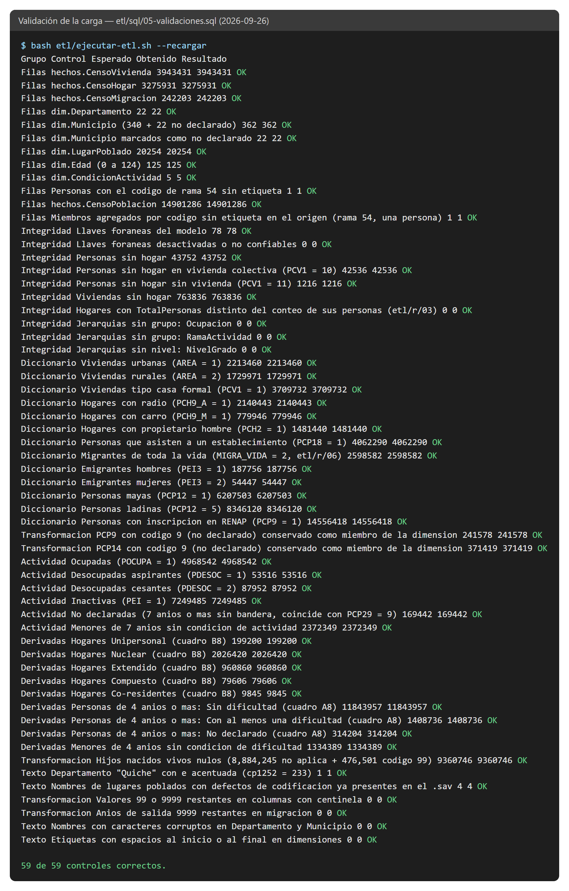

*Figura 6. Los 59 controles de la carga, todos correctos.*

### 4.5 API

```bash
docker compose up -d api
curl http://localhost:5000/salud                 # {"estado":"ok"}
```

Documentación interactiva (Swagger): `http://localhost:5000/swagger`, solo con `ASPNETCORE_ENVIRONMENT=Development`.

### 4.6 Verificación

```bash
dotnet test pruebas/Censo.Pruebas.Aplicacion                                    # 80 correctas
dotnet test pruebas/Censo.Pruebas.BaseDatos                                     # 150 correctas
dotnet test pruebas/Censo.Pruebas.Integracion                                   # 283 correctas
dotnet test pruebas/Censo.Pruebas.Integracion --filter "Categoria=Exactitud"   # 124,509 celdas, 0 diferencias
```

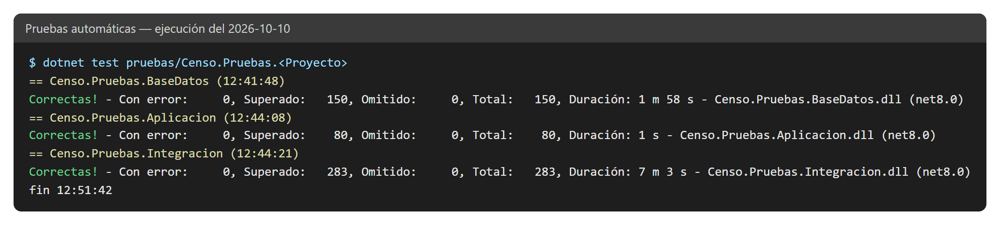

*Figura 7. Resultado de las suites automáticas.*

La prueba de exactitud compara el sistema con los 25 cuadros oficiales del INE para el país, los 22 departamentos y los 340 municipios. **Si da 0 diferencias, la instalación reproduce las cifras oficiales.** Conteos, consultas de comprobación y resultados de referencia: `docs/pruebas.md`.

---

## 5. Base de datos

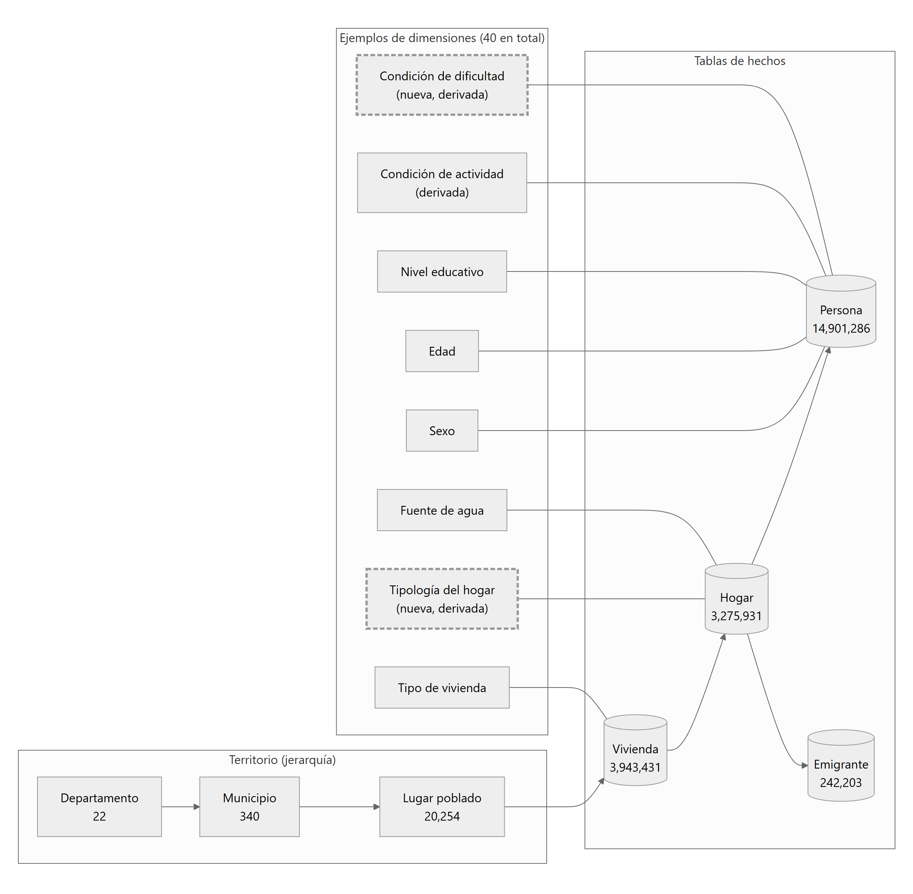

*Figura 8. Modelo dimensional simplificado: cadena vivienda, hogar y persona, y territorio en tres niveles. Modelo completo: `docs/diagramas/modelo-datos.md`.*

| Esquema | Contenido |
|---|---|
| `dim` | 40 tablas de dimensión (`Dim.Departamento`, `Dim.Municipio`, `Dim.LugarPoblado`, `Dim.Edad`, ...) |
| `hechos` | `CensoVivienda`, `CensoHogar`, `CensoPoblacion` y `CensoMigracion`, con índice columnstore agrupado |
| `stage` | Copia de los microdatos con los nombres del INE (`PCP7`, `LUGAR_POBLADO`); se recrea en cada carga |
| `seg` | Reservado para seguridad y auditoría |

`CensoApi` solo tiene `SELECT` sobre `dim` y `hechos`: no puede leer `stage` ni modificar datos u objetos.

---

## 6. API de consultas

### 6.1 Servicios

| Método y ruta | Descripción | Códigos |
|---|---|---|
| `GET /salud` | Estado de la API y de la conexión a la base | 200, 503 |
| `GET /api/catalogo/hechos` | Hechos consultables | 200 |
| `GET /api/catalogo/dimensiones` | Dimensiones y niveles | 200 |
| `GET /api/catalogo/medidas` | Medidas | 200 |
| `GET /api/catalogo/indicadores` | Indicadores con fórmula y fuente | 200 |
| `GET /api/catalogo/operadores` | Operadores de filtro | 200 |
| `POST /api/consultas` | Ejecuta una consulta | 200, 400, 413, 415, 429, 500, 504 |

`dimensiones`, `medidas` e `indicadores` aceptan `?hecho=poblacion|hogar|vivienda|migracion`. Catálogo completo: `docs/catalogo.md`.

### 6.2 Contrato de `POST /api/consultas`

```json
{
  "medidas": ["personas"],
  "indicadores": ["tasaAlfabetismo"],
  "dimensiones": ["departamento", "sexo"],
  "filtros": [{ "nivel": "edad", "operador": "Entre", "valores": [15, 29] }],
  "limite": 10000,
  "incluirComponentes": true
}
```

| Campo | Regla |
|---|---|
| `medidas` + `indicadores` | Al menos 1 y como máximo 12; todos del mismo hecho |
| `dimensiones` | Hasta 6 niveles disponibles para ese hecho |
| `filtros` | Hasta 20; operadores `Igual`, `Distinto`, `En`, `NoEn` (hasta 500 valores), `Entre`, `MayorOIgual`, `MenorOIgual` |
| `limite` | 1 a 100,000 filas (10,000 por defecto); si hay más, `truncado = true` |
| `incluirComponentes` | Agrega `<indicador>_numerador` y `_denominador` a cada fila (por defecto `true`) |
| Tamaño del cuerpo | Máximo 64 KB (413) |

La respuesta trae `hecho`, `columnas`, `filas`, `truncado` y `duracionMs`.

```bash
curl -s -H "Content-Type: application/json" http://localhost:5000/api/consultas \
  -d '{"indicadores":["tasaAlfabetismo"],"dimensiones":["pueblo","sexo"],"filtros":[{"nivel":"departamento","operador":"Igual","valores":[14]}]}'
```

### 6.3 Seguridad y límites

| Control | Implementación |
|---|---|
| Lista blanca | Toda clave se valida contra el catálogo antes de generar SQL (400 con la lista de errores) |
| Inyección SQL | Identificadores tomados solo del catálogo; valores como parámetros de Dapper |
| Privilegios mínimos | Usuario `CensoApi` con `SELECT` en `dim` y `hechos` |
| Disponibilidad | 120 solicitudes por minuto por IP (429); cuerpo máximo de 64 KB (413); consulta máxima de 60 s (504) |
| Errores | Respuestas genéricas, sin trazas ni mensajes internos |
| Contenedor | La imagen de la API corre con el usuario sin privilegios `app` |

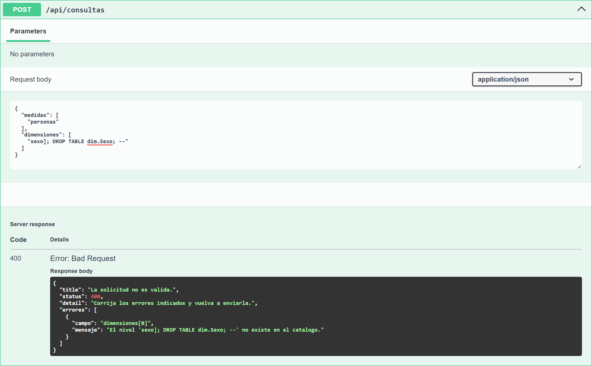

*Figura 9. Un intento de inyección en el nombre de un nivel se rechaza con 400 sin llegar a la base.*

### 6.4 Configuración

| Variable de entorno | Uso | Por defecto |
|---|---|---|
| `ConnectionStrings__CensoDb` | Cadena de conexión con el usuario `CensoApi` | Obligatoria (docker-compose la arma desde `.env`) |
| `LimiteSolicitudes__PorMinuto` | Límite por IP | 120 |
| `BaseDatos__TiempoEsperaSegundos` | Tiempo máximo de una consulta en la base | 60 |
| `ASPNETCORE_ENVIRONMENT` | `Development` activa Swagger; `Production` lo apaga | `Development` en local |
| `ASPNETCORE_FORWARDEDHEADERS_ENABLED` | Detrás de un balanceador, limita por la IP real del cliente | `true` en Azure |

---

## 7. Power BI

Power BI **no se conecta a SQL Server**: consume la API, para que las reglas de cálculo estén en un solo lugar. Los indicadores no se recalculan en DAX; solo se re-agregan con el numerador y el denominador que entrega la API.

| Pieza | Archivo | Función |
|---|---|---|
| Parámetro `UrlApi` | `powerbi/paso-a-paso/consultas/01-UrlApi.pq` | Dirección base de la API |
| Función `ConsultarCenso` | `powerbi/consultas/01-ConsultarCenso.pq` | `Web.Contents` con `RelativePath = "api/consultas"`, cuerpo JSON y manejo de errores |
| Consultas de las páginas | `powerbi/paso-a-paso/consultas/03` a `14` | Catálogo, totales, indicadores, pirámide y hogares |
| Consulta libre | `powerbi/paso-a-paso/consultas/15` a `21` | Seis parámetros y la consulta `ConsultaLibre` |
| Medidas DAX | `powerbi/paso-a-paso/medidas/` | Re-agregación: `DIVIDE(SUM(numerador), SUM(denominador)) * multiplicador` |

**Construir el tablero:** `powerbi/guia-paso-a-paso.md`, clic por clic y con los valores esperados en cada paso. El `.pbix` no se versiona.

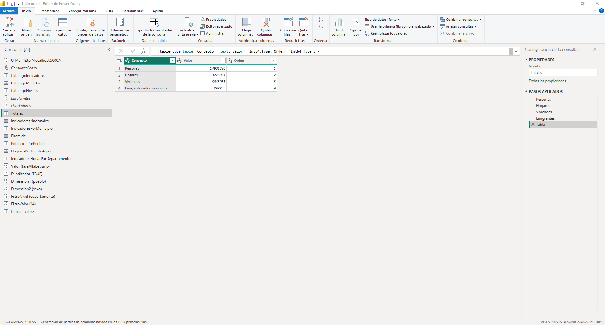

*Figura 10. Las 21 consultas en Power Query y la consulta `Totales`.*

**Configuración obligatoria del archivo:**

1. *Archivo > Opciones > Archivo actual > Privacidad > Omitir los niveles de privacidad.* Sin esto, Power Query bloquea la combinación de consultas.
2. Credencial de la URL de la API: **Anónima**.
3. Desactivar la carga de `ConsultarCenso`, `ListaNiveles` y `ListaValores`.

**Cambiar de entorno:** *Transformar datos > Editar parámetros > UrlApi* = `http://localhost:5000/` o `https://<aplicacion>.azurewebsites.net/` (con la barra final), y *Aplicar cambios*. Una actualización completa envía unas 12 solicitudes; contra Azure tarda cerca de 1.5 minutos.

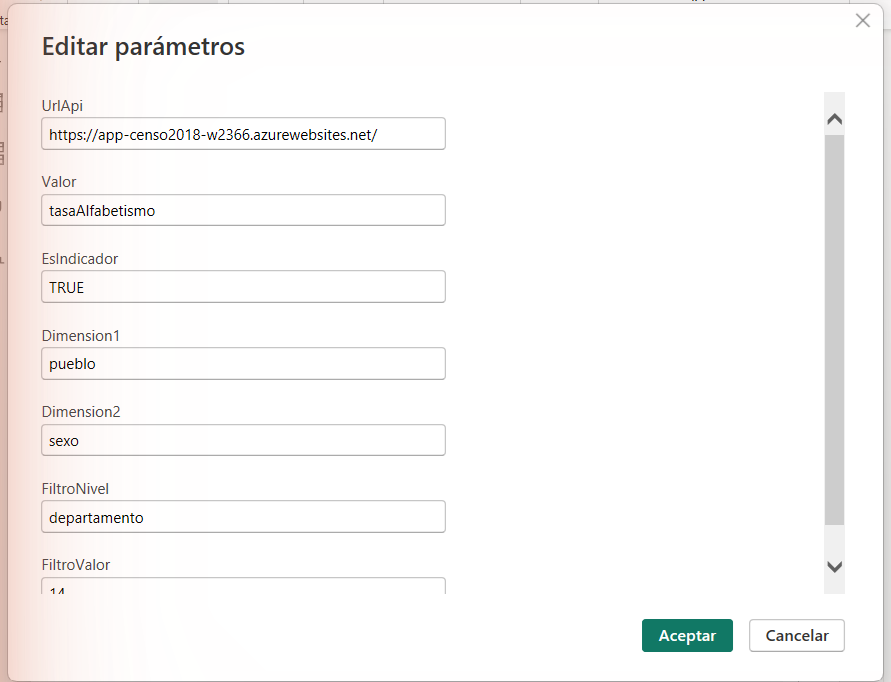

*Figura 11. Parámetro `UrlApi` apuntando a la API en Azure.*

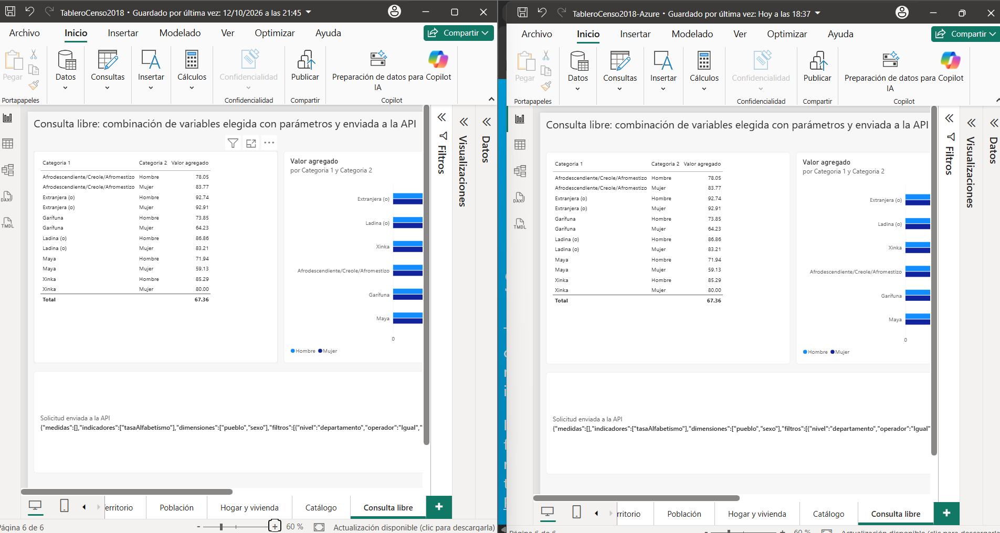

*Figura 12. El mismo tablero contra la API local (izquierda) y contra Azure (derecha): mismos valores.*

---

## 8. Puesta en producción en Azure

### 8.1 Arquitectura de producción

| Recurso | Configuración |
|---|---|
| Grupo de recursos | `AZURE_RESOURCE_GROUP` (por defecto `rg-censo2018`), región `AZURE_LOCATION` (por defecto `westus`) |
| Azure SQL Database | `CensoGT2018`, oferta gratuita sin servidor (*serverless*) General Purpose, 2 vCore, tamaño máximo de 10 GB, pausa automática a los 60 min |
| App Service | Plan Linux (F1 gratuito; B1 o B2 por horas), .NET 8, solo HTTPS, TLS 1.2, `ASPNETCORE_ENVIRONMENT=Production` |
| Acceso | Usuario contenido `CensoApi` de solo lectura; firewall con la IP del equipo administrador y los servicios de Azure |
| Costos | Alerta de presupuesto de USD 30 al mes |

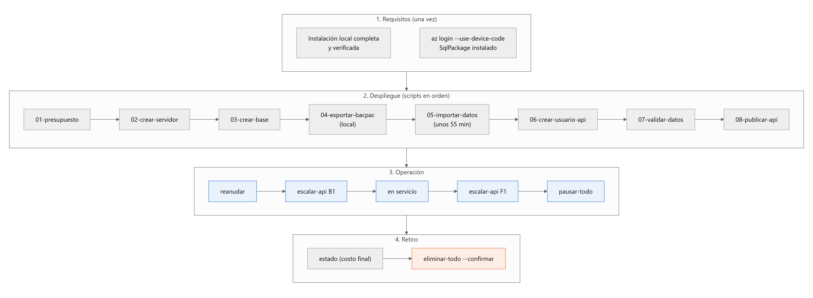

*Figura 13. Scripts de despliegue y de operación.*

### 8.2 Requisitos previos

1. Instalación local completa y verificada (sección 4): la base que se publica es la base local ya cargada.
2. `az login --use-device-code` con la suscripción en la que se creará todo.
3. SqlPackage, Python y .NET SDK instalados.
4. En `.env`, revisar `AZURE_RESOURCE_GROUP`, `AZURE_LOCATION`, `AZURE_SQL_ADMIN` y `AZURE_APP_PLAN`. Los scripts generan y guardan ahí el nombre del servidor, la aplicación y las claves.

### 8.3 Despliegue paso a paso

| Paso | Comando | Qué hace | Resultado esperado |
|---|---|---|---|
| 1 | `bash despliegue/scripts/01-presupuesto.sh <correo>` | Alerta de presupuesto mensual | Avisos al 50 %, al 100 % y por pronóstico |
| 2 | `bash despliegue/scripts/02-crear-servidor.sh` | Grupo de recursos, servidor SQL y firewall | Servidor `sql-censo2018-xxxxx` |
| 3 | `bash despliegue/scripts/03-crear-base.sh` | Base gratuita vacía, serverless 2 vCore, 10 GB | `GP_S_Gen5_2`, `useFreeLimit = true` |
| 4 | `bash despliegue/scripts/04-exportar-bacpac.sh` | Exporta la base local a `datos/CensoGT2018.bacpac` | Archivo de unos 650 MB (12 min) |
| 5 | `bash despliegue/scripts/05-importar-datos.sh` | Importa el BACPAC en Azure | Unos 55 minutos |
| 6 | `bash despliegue/scripts/06-crear-usuario-api.sh` | Usuario contenido `CensoApi` de solo lectura | Clave guardada en `.env` |
| 7 | `bash despliegue/scripts/07-validar-datos.sh` | Conteos, exactitud, permisos y suite de la base contra Azure | Mismos conteos; 0 diferencias; 16 de 16 permisos |
| 8 | `bash despliegue/scripts/08-publicar-api.sh B1` | Plan, aplicación, configuración y publicación de la API | `https://<aplicacion>.azurewebsites.net/salud` responde `{"estado":"ok"}` |

Para comprobar que la API publicada responde igual que la local:

```bash
python despliegue/scripts/pruebas-consumo.py https://<aplicacion>.azurewebsites.net http://localhost:5000
```

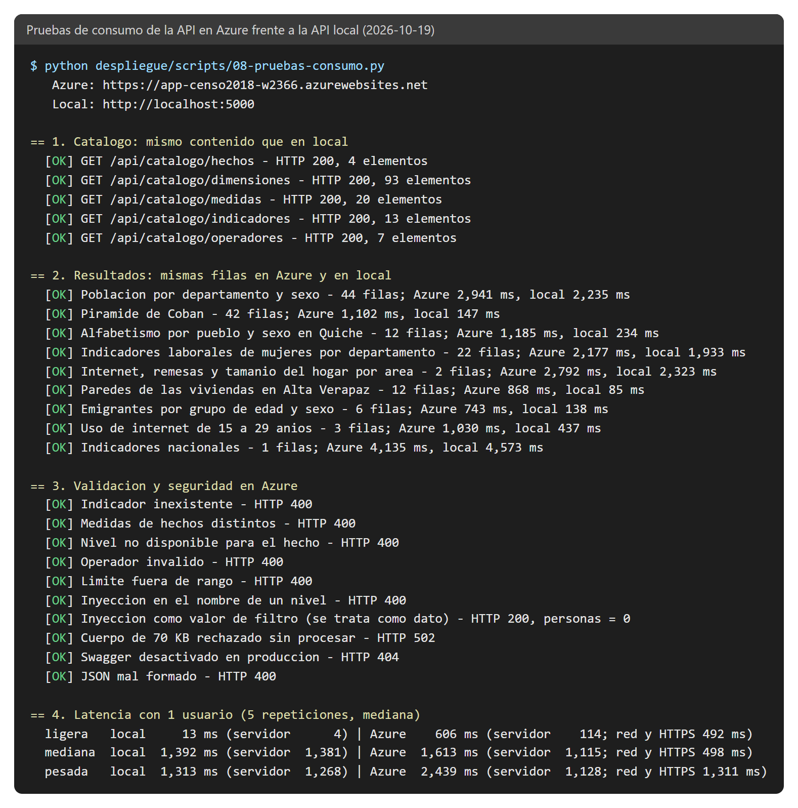

*Figura 14. Pruebas de consumo: catálogo y cuadros idénticos a local, validaciones, Swagger apagado y latencia.*

### 8.4 Dimensionamiento

La capacidad depende de los núcleos de la base de datos (la API usa menos del 10 % de CPU). Con la mezcla de consultas de la prueba de carga:

| Configuración de la base | Usuarios simultáneos con p95 < 5 s | Capacidad |
|---|---:|---:|
| 2 vCore (oferta gratuita) | 1 | ~1.1 solicitudes/s |
| 4 vCore | 5 | ~2.1 solicitudes/s |
| 8 vCore | 10 | ~3.8 solicitudes/s |

Para escalar: `az sql db update -g <grupo> -s <servidor> -n CensoGT2018 --capacity 8 --min-capacity 1`. Con 8 vCore Azure exige un mínimo de 1 vCore. La base conserva la oferta gratuita al escalar dentro de General Purpose, pero el cómputo por encima del cupo mensual (100,000 vCore-segundos) se cobra: unos USD 0.52 por vCore-hora. Detalle: `docs/pruebas.md`.

### 8.5 Operación

| Acción | Comando |
|---|---|
| Ver estado, cupo gratuito y costo del mes | `bash despliegue/scripts/estado.sh` |
| Poner en servicio (abre el firewall, inicia la API y despierta la base) | `bash despliegue/scripts/reanudar.sh` |
| Cambiar el plan de la API | `bash despliegue/scripts/escalar-api.sh F1\|B1\|B2` |
| Despertar la base antes de una demostración | `bash despliegue/scripts/despertar-base.sh` |
| Dejar sin consumo de cómputo (API detenida, firewall cerrado) | `bash despliegue/scripts/pausar-todo.sh` |
| Guardar el uso de CPU tras una prueba de carga | `bash despliegue/scripts/recursos-carga.sh <etiqueta>` |
| Eliminar todo | `bash despliegue/scripts/eliminar-todo.sh --confirmar` |

Prueba de carga contra Azure: subir antes el plan a B2 y el límite de solicitudes, y restaurarlos después:

```bash
K6_BASE_URL=https://<aplicacion>.azurewebsites.net ETIQUETA=azure bash pruebas/carga/ejecutar-carga.sh
```

### 8.6 Costos a vigilar

| Concepto | Detalle |
|---|---|
| Cómputo de la base | Gratis hasta 100,000 vCore-segundos al mes. Con `BillOverUsage` (la opción de `03-crear-base.sh`) el excedente se cobra y **no se puede volver** a pausar al agotar el cupo |
| Almacenamiento de datos | Azure factura el tamaño máximo configurado más un 30 % de registro. Con 10 GB queda dentro de los 32 GB gratuitos |
| Copias de seguridad | Con redundancia geográfica generan un cargo pequeño (unos USD 0.04 al día). En la oferta gratuita no se pudo cambiar a redundancia local |
| API | F1 gratis; B1 USD 0.0187 por hora; B2 USD 0.0374 por hora |

### 8.7 Seguridad en producción

- Las claves viven solo en `.env` (local) y en la configuración de App Service; nunca en el repositorio.
- Swagger está apagado en producción (`/swagger` responde 404).
- La API solo acepta HTTPS con TLS 1.2 y se conecta a la base con cifrado.
- El firewall de la base solo admite la IP del administrador y los servicios de Azure; `pausar-todo.sh` lo cierra por completo.

### 8.8 Alternativa: servidor propio

Para un servidor propio con Docker: usar el mismo `docker-compose.yml` con `ASPNETCORE_ENVIRONMENT=Production`, publicar la API detrás de un proxy inverso con HTTPS (por ejemplo, Nginx o IIS) y no exponer el puerto 1433 de SQL Server. La carga y la verificación son iguales a las de la sección 4.

---

## 9. Mantenimiento

| Tarea | Procedimiento | Verificación |
|---|---|---|
| Agregar un indicador o una medida | Definirlo en `src/Censo.Aplicacion/Catalogo/` (fórmula, numerador, denominador y fuente) y actualizar `docs/catalogo.md` | Pruebas de Aplicacion e Integracion; exactitud con 0 diferencias |
| Agregar una dimensión o un nivel | DDL en `db/02-dimensiones` y `db/03-indices`; carga en `etl/sql/03` y `04`; nivel en el catálogo; `ValoresEsperados.cs` y diagramas | Las pruebas de esquema verifican las convenciones |
| Recargar los datos | `bash etl/ejecutar-etl.sh --recargar` | 59 de 59 controles y exactitud sin diferencias |
| Respaldo | `bash despliegue/scripts/04-exportar-bacpac.sh` o copia del volumen `censo2018_sqlserver_data` | Importar en otra instancia y comparar conteos |
| Rotar la clave de la API | Cambiar `CLAVE_API` en `.env`, `bash db/crear-usuario-api.sh` y `docker compose up -d api` | `/salud` responde 200 |
| Actualizar la API | `docker compose up -d --build api` (local) o `08-publicar-api.sh` (Azure) | Consultas de comprobación de `docs/pruebas.md` |
| Revisar registros | `docker logs censo-api --tail 100` y `docker logs censo-sqlserver --tail 100` | — |

---

## 10. Solución de problemas

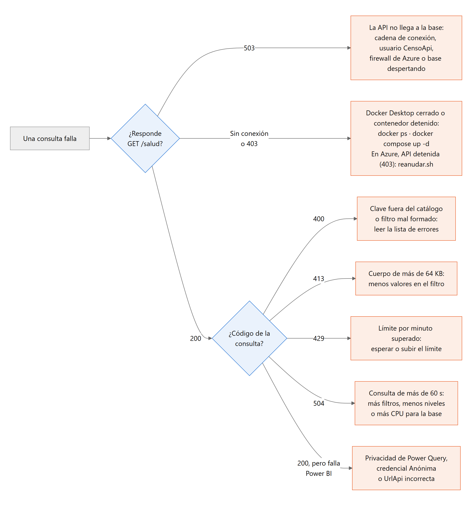

*Figura 15. Ruta de diagnóstico a partir de `/salud` y del código de respuesta.*

### 10.1 Instalación y ETL

| Síntoma | Causa | Solución |
|---|---|---|
| `failed to connect to the docker API` | Docker Desktop cerrado | Abrirlo y esperar a que el motor inicie |
| `censo-sqlserver` nunca llega a *healthy* | Clave `MSSQL_SA_PASSWORD` débil o memoria insuficiente | `docker logs censo-sqlserver`; ajustar la clave o `DB_MEM_LIMIT` |
| `Falta datos/microdatos/...sav` | Los microdatos no están en la carpeta | Copiar los cuatro archivos con sus nombres exactos (sección 4.2) |
| `No se encontro Rscript` | R no está en el PATH | Instalar R o definir `RSCRIPT` en `.env` |
| `Instale los paquetes de R` | Faltan paquetes | Comando de la sección 2.1 |
| Acentos dañados (`é` como `Θ`) | CSV exportados con otra codificación | `bash etl/ejecutar-etl.sh --exportar --recargar` |
| "Código sin dimensión" | Un código del INE no está en su catálogo | Agregar el miembro en `etl/sql/03-cargar-dimensiones.sql` |
| "El modelo debe estar vacío" | Se cargó sobre datos existentes | Usar `--recargar` |

### 10.2 API

| Síntoma | Causa | Solución |
|---|---|---|
| `/salud` responde 503 | La API no llega a la base | Revisar `ConnectionStrings__CensoDb`, que exista `CensoApi` (`bash db/crear-usuario-api.sh`) y, en Azure, el firewall |
| "Falta la cadena de conexion" al arrancar | No se definió `ConnectionStrings__CensoDb` | Definirla (docker-compose lo hace) |
| 400 | Clave fuera del catálogo o filtro inválido | La respuesta lista cada error con su campo |
| 429 | Más solicitudes por minuto que el límite | Esperar o subir `API_LIMITE_POR_MINUTO` |
| 504 | La consulta pasó de 60 s; ocurre con muchos usuarios porque el límite es la CPU de la base | Filtros, menos niveles o más vCore (sección 8.4) |

### 10.3 Power BI

| Síntoma | Causa | Solución |
|---|---|---|
| "Formula.Firewall" | Niveles de privacidad activos | Omitirlos (sección 7) |
| Pide credenciales | Primera conexión a la dirección | **Anónimo** |
| "La API rechazo la consulta (HTTP 400)... [List]" | Clave inválida en un parámetro; el detalle queda en `[List]` | Ver el detalle en Power Query o probar la solicitud en Swagger |
| No conecta con Azure | La API está detenida (403) o `UrlApi` es incorrecta | `reanudar.sh`; revisar `UrlApi` |

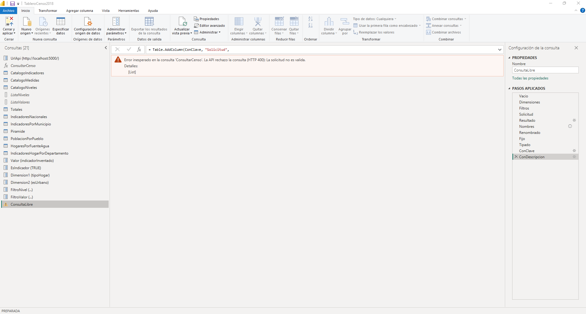

*Figura 16. Error de validación visto en el editor de Power Query.*

### 10.4 Azure

| Síntoma | Causa | Solución |
|---|---|---|
| `ProvisioningDisabled` al crear la base | La oferta gratuita no está disponible en esa región | Otra región permitida por la suscripción (`AZURE_LOCATION`) |
| `ProvisioningDisabled` al escalar a 8 vCore | El mínimo de 0.5 vCore no es válido con 8 vCore | `--min-capacity 1` |
| `despertar-base.sh` falla aunque la base está en línea | Docker Desktop cerrado: el script usa el `sqlcmd` del contenedor local | Abrir Docker y repetir |
| "Database ... is not currently available" | La base sin servidor está despertando (15 a 60 s) | `despertar-base.sh` reintenta cada 15 s |
| `/salud` 503 justo después de reanudar | Arranque en frío de la API (hasta 100 s) | Esperar; con B1 o B2 y "Always On" no se repite |
| "Error 403 - This web app is stopped" | API detenida | `reanudar.sh` |
| Falla la publicación `.zip` | Archivo creado con rutas `\` | Usar `08-publicar-api.sh`, que empaqueta con `empaquetar.py` |
| 502 al enviar más de 64 KB | El balanceador informa 502 cuando la API cierra la conexión | Comportamiento esperado: la solicitud no se procesa |
| Pruebas de permisos con error 2812 o 208 | `xp_cmdshell`, `sp_configure` y `sys.sql_logins` no existen en Azure SQL | Las pruebas lo aceptan como rechazo válido |
| `az` falla con rutas en Git Bash | Conversión de rutas que empiezan con `/` | Anteponer `MSYS_NO_PATHCONV=1` |
| Un nombre leído con `az ... -o tsv` no se encuentra | Salida con `\r` | Filtrar con `tr -d '\r'` |
| La prueba del límite no recibe 429 | En serie, las solicitudes tardan más de un minuto | Enviarlas en paralelo (`pruebas-consumo.py --solo-limite`) |

---

## 11. Referencia rápida

```bash
# Instalación local
cp .env.example .env                 # editar claves
docker compose up -d sqlserver
bash db/crear-esquema.sh
bash db/crear-usuario-api.sh
bash etl/ejecutar-etl.sh
docker compose up -d api
dotnet test pruebas/Censo.Pruebas.Integracion --filter "Categoria=Exactitud"

# Producción en Azure
az login --use-device-code
for s in 02-crear-servidor 03-crear-base 04-exportar-bacpac 05-importar-datos 06-crear-usuario-api 07-validar-datos; do
  bash despliegue/scripts/$s.sh || break
done
bash despliegue/scripts/08-publicar-api.sh B1

# Operación
bash despliegue/scripts/estado.sh
bash despliegue/scripts/reanudar.sh
bash despliegue/scripts/pausar-todo.sh
```
