# Manual de usuario

**Sistema de consulta multidimensional del Censo de Población y Vivienda 2018 de Guatemala**

| | |
|---|---|
| Dirigido a | Analistas y usuarios con conocimientos básicos de Power BI que necesitan obtener cifras e indicadores del Censo 2018 |
| Versión del sistema | API de consultas 1.0 (catálogo de 13 indicadores, 20 medidas y 108 niveles) |
| Fecha | Octubre de 2026 |
| Manual técnico | `docs/manual-tecnico.md` (instalación, mantenimiento y solución de problemas) |

---

## 1. Qué permite hacer el sistema

El sistema responde preguntas sobre el Censo 2018 **combinando las variables que se necesiten**, aunque esa combinación no exista en los cuadros publicados por el INE. Por ejemplo:

- ¿Cuál es la tasa de alfabetismo de las mujeres mayas en Quiché?
- ¿Cuántas viviendas de Alta Verapaz tienen paredes de madera?
- ¿Qué porcentaje de los hogares rurales recibe remesas?

Las cifras se calculan a partir de los microdatos públicos del INE y coinciden con sus 25 cuadros oficiales (124,509 celdas comparadas, sin diferencias).

### 1.1 Cómo funciona

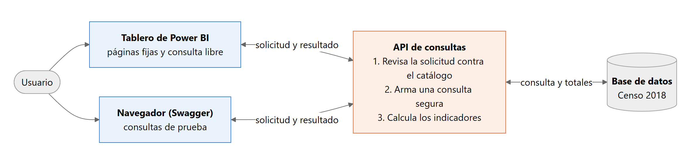

*Figura 1. El usuario consulta desde Power BI o desde el navegador; la API revisa la solicitud, consulta la base de datos y calcula los indicadores.*

Lo importante para el usuario: **los indicadores los calcula la API, no Power BI.** Así, el tablero, el navegador o cualquier otra herramienta obtienen siempre el mismo resultado.

### 1.2 Dos formas de consultar

| Herramienta | Para qué sirve | Requiere |
|---|---|---|
| **Tablero de Power BI** | Explorar páginas ya armadas y hacer consultas libres eligiendo parámetros | Power BI Desktop y el tablero construido con `powerbi/guia-paso-a-paso.md` |
| **Navegador (Swagger)** | Probar una consulta exacta y ver la respuesta completa | Solo un navegador web |

Dirección de la API: `http://localhost:5000` en el equipo local, o la dirección publicada en Azure (`https://<aplicacion>.azurewebsites.net`) que indique el administrador. El tablero funciona igual con cualquiera de las dos: solo cambia el parámetro `UrlApi` (manual técnico, sección 6).

---

## 2. Cómo se arma una consulta

Toda consulta responde tres preguntas:

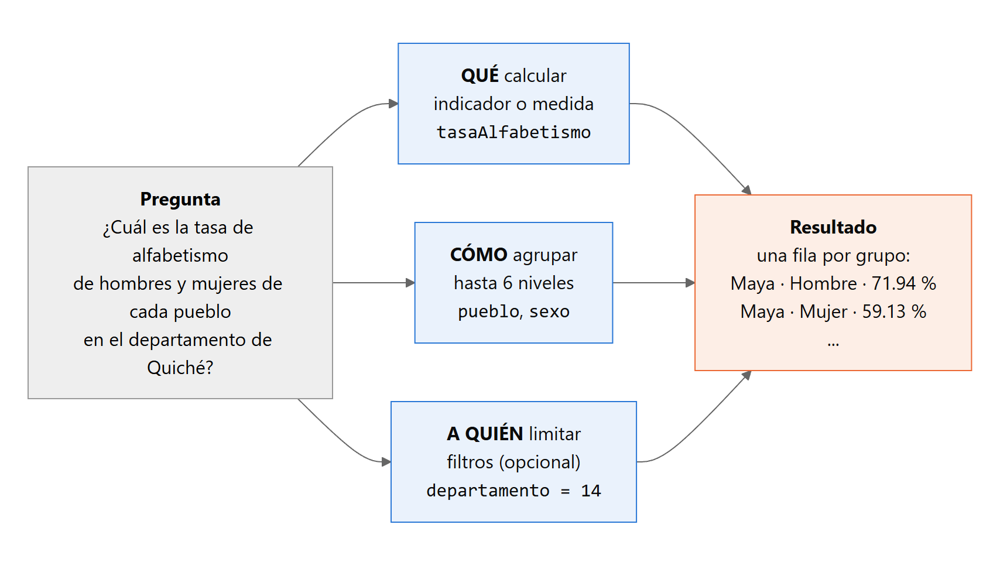

*Figura 2. Una pregunta se traduce en qué calcular, cómo agrupar y a quién limitar.*

| Parte | Qué es | Ejemplos de claves |
|---|---|---|
| **Medida** (qué contar) | Un conteo | `personas`, `hogares`, `viviendas`, `emigrantes`, `pea` |
| **Indicador** (qué calcular) | Una tasa o un índice formado por dos medidas | `tasaAlfabetismo`, `indiceMasculinidad`, `tamanioPromedioHogar` |
| **Nivel** (cómo agrupar) | Una variable para formar grupos; hasta 6 por consulta | `departamento`, `municipio`, `sexo`, `grupoQuinquenal`, `pueblo`, `esUrbano` |
| **Filtro** (a quién limitar) | Un nivel con una condición; hasta 20 por consulta | `departamento` igual a 14; `edad` entre 15 y 29 |

Reglas sencillas:

- Las medidas e indicadores de una misma consulta deben ser del mismo tema (personas, hogares, viviendas o emigración). Por ejemplo, no se pueden pedir `personas` y `hogares` juntos.
- Los niveles y filtros usan **códigos del INE**: departamento 14 es Quiché; municipio 1601 es Cobán; sexo 1 es hombre y 2 es mujer.
- La lista completa de claves está en el catálogo (`docs/catalogo.md`) y en la propia API (`GET /api/catalogo/indicadores`, `.../medidas`, `.../dimensiones`).

### 2.1 Indicadores disponibles

| Indicador (clave) | Fórmula |
|---|---|
| Índice de masculinidad (`indiceMasculinidad`) | hombres / mujeres × 100 |
| Relación de dependencia (`relacionDependencia`) | (0 a 14 años + 65 y más) / 15 a 64 años × 100 |
| Tasa global de participación (`tasaGlobalParticipacion`) | PEA / PET × 100 |
| Tasa bruta de ocupación (`tasaBrutaOcupacion`) | ocupados / PET × 100 |
| Tasa específica de ocupación (`tasaEspecificaOcupacion`) | ocupados / PEA × 100 |
| Tasa de desempleo abierto (`tasaDesempleoAbierto`) | desocupados / PEA × 100 |
| Tasa de alfabetismo (`tasaAlfabetismo`) | alfabetas de 7 años o más / personas de 7 años o más × 100 |
| Porcentaje de migrantes de toda la vida (`porcentajeMigrantesVida`) | migrantes de toda la vida / personas × 100 |
| Tamaño promedio del hogar (`tamanioPromedioHogar`) | personas en hogares / hogares |
| Porcentaje de hogares con internet (`porcentajeHogaresConInternet`) | hogares con internet / hogares × 100 |
| Porcentaje de hogares con remesas (`porcentajeHogaresConRemesas`) | hogares con remesas / hogares × 100 |
| Porcentaje de viviendas ocupadas (`porcentajeViviendasOcupadas`) | viviendas ocupadas / viviendas × 100 |
| Porcentaje de emigrantes mujeres (`porcentajeEmigrantesMujeres`) | emigrantes mujeres / emigrantes × 100 |

Fuente de las fórmulas: Glosario de definiciones del Censo 2018 (INE).

---

## 3. Uso del tablero de Power BI

### 3.1 Antes de empezar

1. Confirmar con el administrador que la API está en funcionamiento (en el equipo local: abrir `http://localhost:5000/salud` en el navegador; debe mostrar `{"estado":"ok"}`).
2. Abrir el tablero (`.pbix`) en Power BI Desktop. Si todavía no existe, se construye con `powerbi/guia-paso-a-paso.md`.
3. Pulsar **Inicio > Actualizar** para traer los datos más recientes de la API.

El tablero tiene seis páginas (pestañas en la parte inferior).

### 3.2 Página «Panorama nacional»

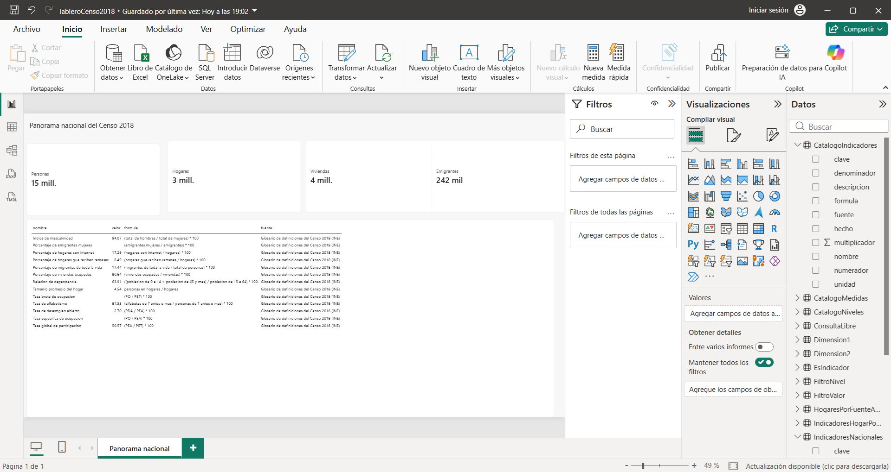

*Figura 3. Totales del censo y los indicadores nacionales con su fórmula y fuente.*

Muestra los cuatro totales (personas, hogares, viviendas y emigrantes) y una tabla con los indicadores nacionales. Las tarjetas abrevian las cifras ("15 mill."); para ver el valor exacto, clic derecho en la tarjeta > **Mostrar como tabla**.

### 3.3 Página «Territorio»

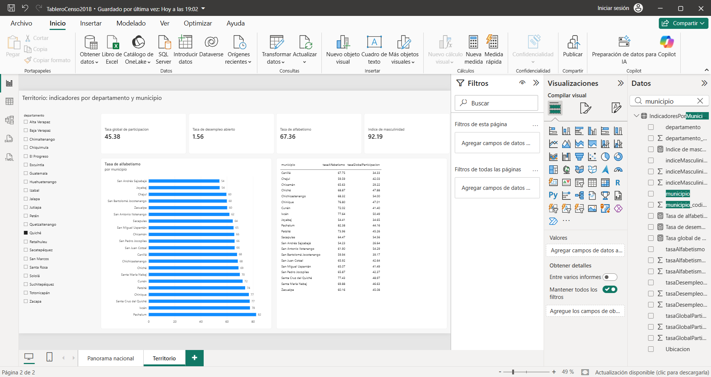

*Figura 4. Indicadores de Quiché y alfabetismo por municipio.*

1. En la lista de la izquierda, seleccionar un departamento (por ejemplo, Quiché).
2. Las tarjetas muestran los indicadores del departamento: participación 45.38 %, desempleo 1.56 %, alfabetismo 67.36 % e índice de masculinidad 92.19.
3. La gráfica ordena los municipios por tasa de alfabetismo; la tabla de la derecha da los valores exactos.

Para volver al total nacional, quitar la selección (clic otra vez sobre el departamento).

### 3.4 Página «Población»

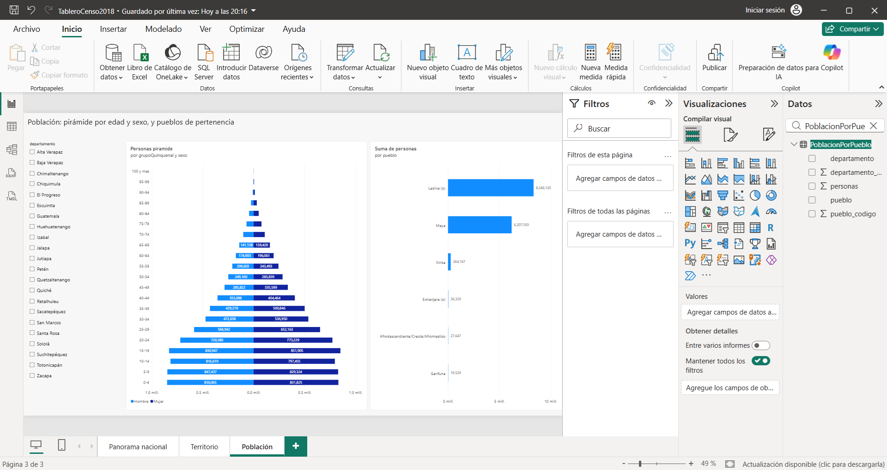

*Figura 5. Pirámide de edad por sexo y población por pueblo de pertenencia.*

La pirámide se filtra por departamento con la lista de la izquierda. Pasar el cursor sobre una barra muestra el número exacto de personas.

### 3.5 Página «Hogar y vivienda»

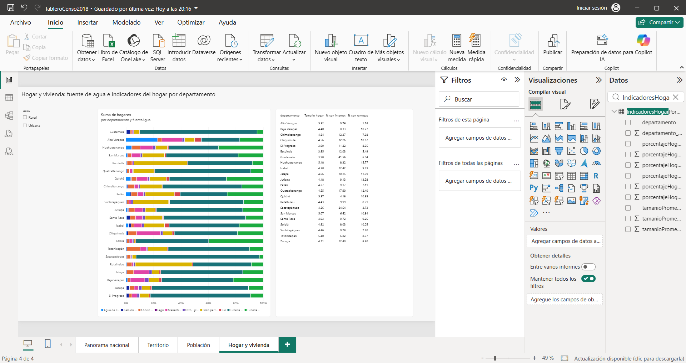

*Figura 6. Fuente de agua por departamento y tabla de indicadores del hogar.*

La gráfica muestra, para cada departamento, la proporción de hogares según su fuente de agua. La lista **Área** permite ver solo hogares urbanos o rurales.

### 3.6 Página «Catálogo»

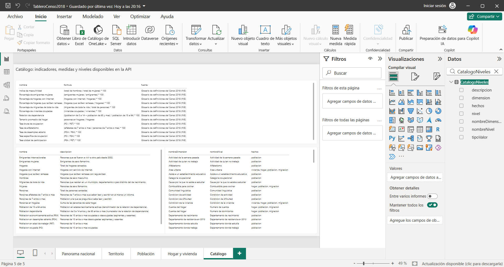

*Figura 7. Indicadores, medidas y niveles disponibles.*

Sirve como referencia de las claves que se pueden usar en la consulta libre.

### 3.7 Página «Consulta libre»: cuadros a la medida

Es la página que permite **elegir la combinación de variables**. La consulta se define con seis parámetros:

| Parámetro | Qué indica | Ejemplo |
|---|---|---|
| `Valor` | La medida o el indicador | `tasaAlfabetismo` |
| `EsIndicador` | `true` si `Valor` es un indicador; `false` si es una medida | `true` |
| `Dimension1` | Primer nivel para agrupar (obligatorio) | `pueblo` |
| `Dimension2` | Segundo nivel (opcional) | `sexo` |
| `FiltroNivel` | Nivel por el que se filtra (opcional) | `departamento` |
| `FiltroValor` | Código del filtro (opcional) | `14` |

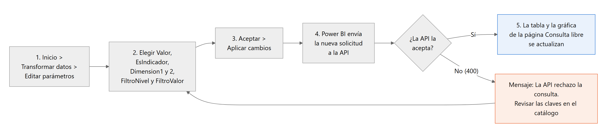

*Figura 8. Pasos para cambiar la consulta libre.*

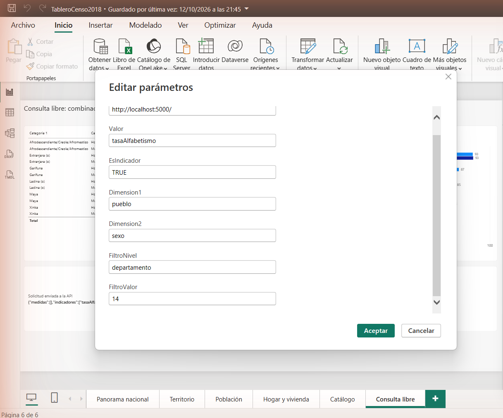

*Figura 9. Cuadro «Editar parámetros» con la consulta del ejemplo 1.*

**Pasos:**

1. **Inicio > Transformar datos > Editar parámetros.**
2. Escribir o elegir los valores de los seis parámetros. Para dejar un parámetro opcional vacío, borrar su contenido.
3. **Aceptar** y, en la barra amarilla que aparece, **Aplicar cambios**.
4. La tabla, la gráfica y el recuadro "Solicitud enviada a la API" se actualizan.

**Ejemplo 1. Alfabetismo por pueblo y sexo en Quiché** (`tasaAlfabetismo`, `true`, `pueblo`, `sexo`, `departamento`, `14`):

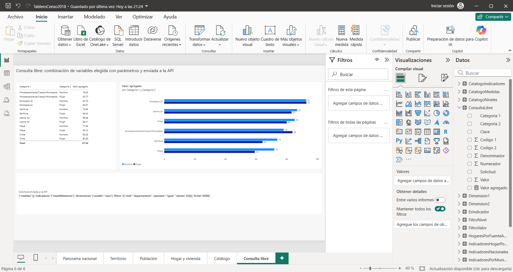

*Figura 10. Resultado: hombres mayas 71.94 %, mujeres mayas 59.13 %.*

**Ejemplo 2. Hogares por tipología y área** (`hogares`, `false`, `tipoHogar`, `esUrbano`, vacío, vacío):

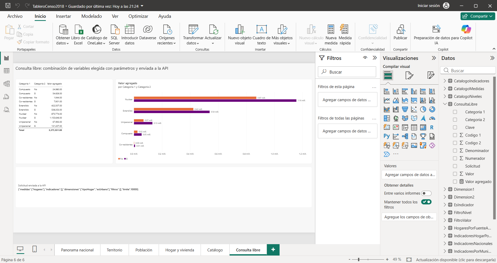

*Figura 11. Resultado: hogares nucleares, 870,774 rurales ("No") y 1,155,646 urbanos ("Sí").*

En los niveles de tipo Sí/No (`esUrbano`, `tieneInternet`, ...) el resultado muestra "Si" y "No"; en `esUrbano`, "Si" significa urbano.

**Si una clave está mal escrita**, Power BI muestra el aviso "La API rechazo la consulta (HTTP 400)". Revisar la ortografía en la página Catálogo y volver al paso 1.

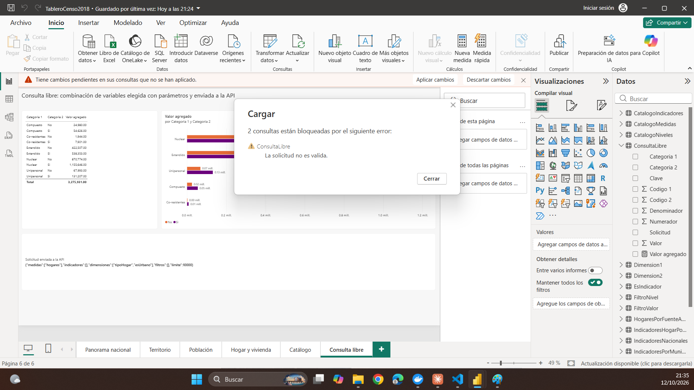

*Figura 12. Aviso cuando el indicador no existe en el catálogo.*

---

## 4. Consultas desde el navegador (Swagger)

Swagger es una página web de la API para escribir una solicitud y ver la respuesta. Está disponible en el entorno local (`http://localhost:5000/swagger`); en Azure está desactivada por seguridad.

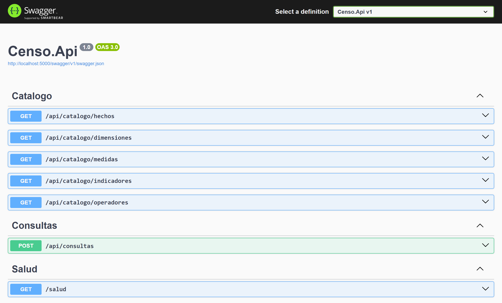

*Figura 13. Servicios de la API en Swagger.*

**Pasos:**

1. Abrir `http://localhost:5000/swagger`.
2. Abrir **POST /api/consultas** y pulsar **Try it out**.
3. Reemplazar el contenido del recuadro por la solicitud (sección 5).
4. Pulsar **Execute**. El resultado aparece en **Response body**.

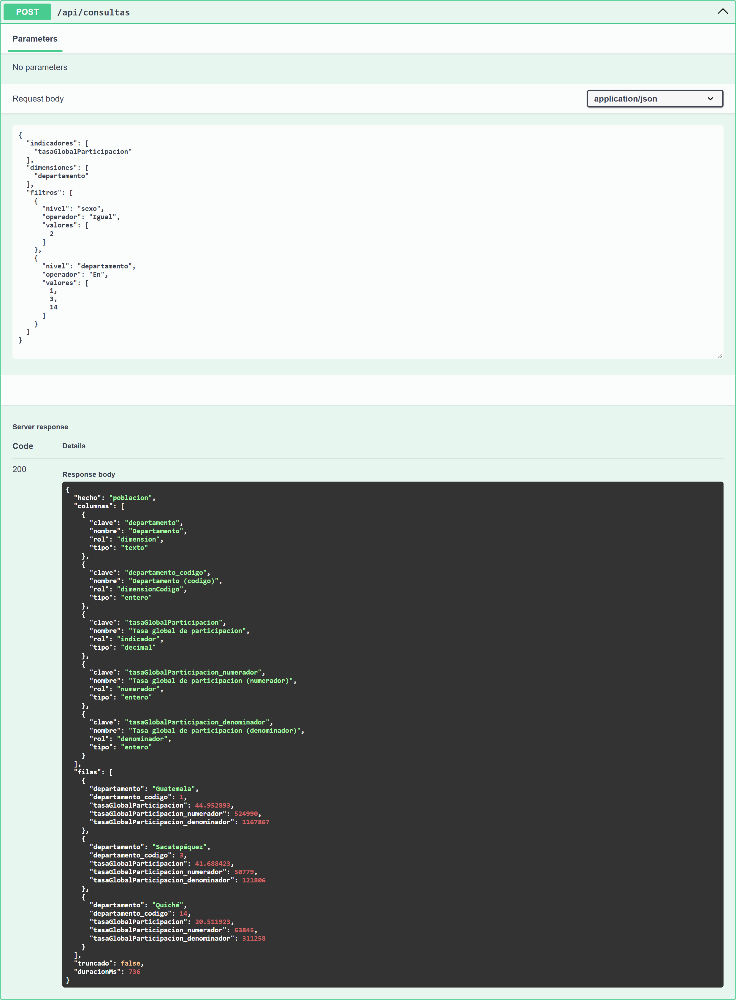

*Figura 14. Solicitud y respuesta: tasa de participación de las mujeres en tres departamentos.*

El tablero y Swagger dan el mismo resultado, porque los dos consultan la misma API:

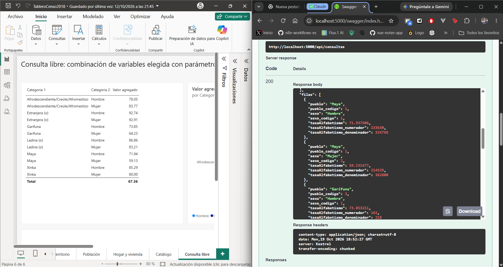

*Figura 15. Power BI (71.94) y la respuesta de la API en Swagger (71.937506) para la misma consulta.*

Para consultar el catálogo desde Swagger: **GET /api/catalogo/indicadores** (o `medidas`, `dimensiones`, `operadores`) > **Try it out** > **Execute**.

---

## 5. Cuadros que se pueden realizar (ejemplos)

Cada ejemplo trae la solicitud lista para copiar en Swagger y un extracto del resultado real. En Power BI, los mismos cuadros se obtienen con los parámetros de la consulta libre cuando usan hasta dos niveles y un filtro.

### 5.1 Población por departamento y sexo

```json
{ "medidas": ["personas"], "dimensiones": ["departamento", "sexo"] }
```

| departamento | sexo | personas |
|---|---|---:|
| Guatemala | Hombre | 1,449,203 |
| Guatemala | Mujer | 1,565,878 |
| El Progreso | Hombre | 87,172 |
| ... | ... | ... |

44 filas (22 departamentos × 2 sexos).

### 5.2 Pirámide de población de un municipio (Cobán)

```json
{
  "medidas": ["personas"],
  "dimensiones": ["grupoQuinquenal", "sexo"],
  "filtros": [{ "nivel": "municipio", "operador": "Igual", "valores": [1601] }]
}
```

| grupoQuinquenal | sexo | personas |
|---|---|---:|
| 0-4 | Hombre | 12,622 |
| 0-4 | Mujer | 12,631 |
| 5-9 | Hombre | 13,130 |
| ... | ... | ... |

### 5.3 Indicadores laborales de las mujeres por departamento

```json
{
  "indicadores": ["tasaGlobalParticipacion", "tasaDesempleoAbierto"],
  "dimensiones": ["departamento"],
  "filtros": [{ "nivel": "sexo", "operador": "Igual", "valores": [2] }]
}
```

| departamento | Tasa global de participación | Tasa de desempleo abierto |
|---|---:|---:|
| Guatemala | 44.95 | 2.75 |
| El Progreso | 26.83 | 2.36 |
| Sacatepéquez | 41.69 | 1.81 |
| ... | ... | ... |

### 5.4 Hogares con internet y remesas, urbano frente a rural

```json
{
  "indicadores": ["porcentajeHogaresConInternet", "porcentajeHogaresConRemesas", "tamanioPromedioHogar"],
  "dimensiones": ["esUrbano"]
}
```

| esUrbano | % con internet | % con remesas | Tamaño promedio |
|---|---:|---:|---:|
| No (rural) | 3.52 | 9.57 | 4.95 |
| Si (urbano) | 27.36 | 7.69 | 4.23 |

### 5.5 Material de las paredes de las viviendas en Alta Verapaz

```json
{
  "medidas": ["viviendas"],
  "dimensiones": ["materialPared"],
  "filtros": [{ "nivel": "departamento", "operador": "Igual", "valores": [16] }]
}
```

Principales resultados: madera 134,580 viviendas; block 78,217; lámina metálica 7,653; concreto 5,431.

### 5.6 Emigrantes por grupo de edad y sexo

```json
{ "medidas": ["emigrantes"], "dimensiones": ["grupoAmplio", "sexo"] }
```

| grupoAmplio | Hombre | Mujer |
|---|---:|---:|
| 0-14 | 9,292 | 4,944 |
| 15-64 | 177,988 | 49,137 |
| 65 y más | 476 | 366 |

### 5.7 Jóvenes de 15 a 29 años que usan internet

```json
{
  "medidas": ["personas"],
  "dimensiones": ["usoInternet"],
  "filtros": [{ "nivel": "edad", "operador": "Entre", "valores": [15, 29] }]
}
```

Resultado: sí 1,832,651; no 2,521,747; no declarado 59,168.

### 5.8 Indicadores nacionales en una sola consulta

Sin niveles, la consulta devuelve una sola fila con el total del país:

```json
{ "indicadores": ["indiceMasculinidad", "relacionDependencia", "tasaAlfabetismo"] }
```

Resultado: índice de masculinidad 94.07; relación de dependencia 63.91; tasa de alfabetismo 81.53.

### 5.9 Operadores de filtro

| Operador | Uso | Ejemplo de valores |
|---|---|---|
| `Igual` / `Distinto` | Un valor | `[14]` |
| `En` / `NoEn` | Varios valores (hasta 500) | `[1, 3, 14]` |
| `Entre` | Rango, inclusive | `[15, 29]` |
| `MayorOIgual` / `MenorOIgual` | Un límite | `[65]` |

---

## 6. Cómo leer el resultado

En Swagger, cada fila de la respuesta tiene estas partes (ejemplo del cuadro 5.3, fila de Guatemala):

| Campo | Valor | Significado |
|---|---|---|
| `departamento` | Guatemala | Nombre del grupo |
| `departamento_codigo` | 1 | Código del INE |
| `tasaGlobalParticipacion` | 44.952893 | Valor del indicador (44.95 %) |
| `tasaGlobalParticipacion_numerador` | 524,990 | Mujeres en la PEA |
| `tasaGlobalParticipacion_denominador` | 1,167,867 | Mujeres en edad de trabajar (PET) |

Otros campos: `truncado` es `true` si el resultado superó el límite de filas (10,000 por defecto; se puede pedir hasta 100,000 con `"limite"`), y `duracionMs` es el tiempo que tardó la consulta.

**Valores especiales:**

- **"No aplica":** personas a quienes no se hizo la pregunta. Por ejemplo, el nivel educativo de los menores de 4 años.
- **"No declarado":** la persona no respondió esa pregunta.
- **Indicador vacío:** el grupo no tiene denominador (por ejemplo, desempleo entre niños de 0 a 14 años).

### 6.1 Sumar grupos sin perder exactitud

Un indicador **nunca se promedia** entre grupos. Para juntar grupos se suman los numeradores y los denominadores, y luego se divide.

Ejemplo, participación de las mujeres de Guatemala y Sacatepéquez juntas:

| | Numerador | Denominador |
|---|---:|---:|
| Guatemala | 524,990 | 1,167,867 |
| Sacatepéquez | 50,779 | 121,806 |
| **Suma** | **575,769** | **1,289,673** |

Resultado correcto: 575,769 / 1,289,673 × 100 = **44.64 %**. El promedio simple de las dos tasas, (44.95 + 41.69) / 2 = 43.32 %, sería incorrecto. El tablero de Power BI ya hace este cálculo en sus tarjetas.

---

## 7. Mensajes de error

| Mensaje | Qué pasó | Qué hacer |
|---|---|---|
| "El indicador / nivel 'x' no existe en el catalogo" (400) | Una clave mal escrita o inexistente | Revisar la clave en el catálogo |
| "Las medidas e indicadores de una consulta deben pertenecer al mismo hecho" (400) | Se mezclaron temas distintos | Hacer dos consultas separadas |
| "El nivel 'x' no esta disponible para el hecho 'y'" (400) | Ese nivel no aplica al tema elegido (por ejemplo, `pueblo` con `hogares`) | Ver en el catálogo los hechos de cada nivel |
| "Demasiadas solicitudes" (429) | Más de 120 consultas en un minuto | Esperar un minuto |
| "La consulta tardo mas de lo permitido" (504) | La consulta superó 60 segundos | Agregar un filtro o usar menos niveles |
| Power BI: "La API rechazo la consulta (HTTP 400)" | Un parámetro de la consulta libre tiene una clave inválida | Revisar los parámetros (sección 3.7) |
| Power BI no actualiza o no conecta | La API no está disponible | Avisar al administrador (manual técnico, sección de solución de problemas) |

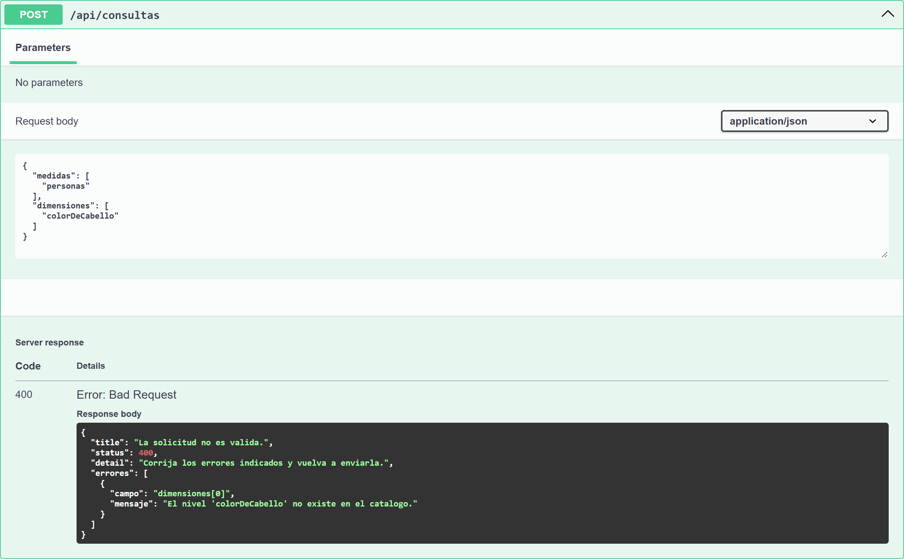

*Figura 16. La API indica exactamente qué parte de la solicitud está mal.*

---

## 8. Recomendaciones

- Empezar con consultas pequeñas (un departamento) y ampliar después.
- Usar los códigos del INE en los filtros; los nombres aparecen en el resultado.
- Las consultas por municipio cruzadas con otra variable son las más pesadas: si tardan, agregar un filtro por departamento.
- Para juntar grupos, usar numerador y denominador (sección 6.1).
- Los resultados coinciden con los cuadros oficiales del INE, pero **no son una publicación oficial** del Instituto. Al citarlos: "Elaboración propia con base en los microdatos del Censo 2018 (INE)".
