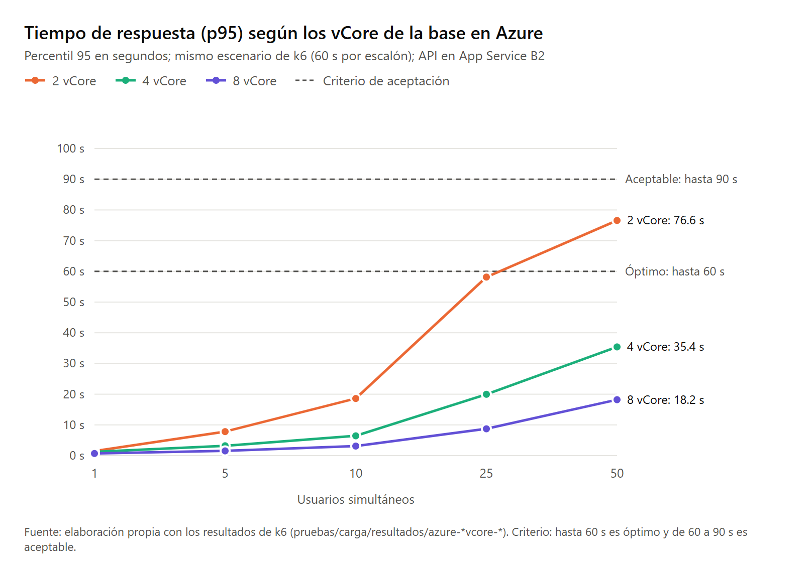

# Pruebas y resultados de referencia

Qué pruebas trae el repositorio, cómo ejecutarlas y qué resultados se obtuvieron en la instalación de referencia. Sirven para comprobar que una instalación nueva quedó correcta: los conteos, las pruebas automáticas y la exactitud deben coincidir **exactamente**; los tiempos dependen del equipo.

## 1. Niveles de prueba

| Nivel | Qué comprueba | Cómo se ejecuta | Resultado de referencia |
|---|---|---|---|
| Controles de la carga | Conteos, integridad referencial, cifras del diccionario del INE, clasificaciones derivadas, valores centinela y codificación | Al final de `bash etl/ejecutar-etl.sh` (`etl/sql/05-validaciones.sql`) | 59 de 59 controles correctos |
| Base de datos | Esquema y convenciones, carga, calidad, consistencia entre `stage` y el modelo, propiedades del esquema en estrella, rendimiento base | `dotnet test pruebas/Censo.Pruebas.BaseDatos` | 150 de 150 |
| Aplicación (sin base) | Catálogo, validador, constructor de SQL y servicio con un repositorio simulado | `dotnet test pruebas/Censo.Pruebas.Aplicacion` | 80 de 80 |
| Integración | API (HTTP), motor de consultas, seguridad (permisos de `CensoApi`, inyección) y exactitud | `dotnet test pruebas/Censo.Pruebas.Integracion` | 283 de 283 |
| Exactitud | Los 25 cuadros oficiales del INE, celda por celda, para el país, 22 departamentos y 340 municipios | `dotnet test pruebas/Censo.Pruebas.Integracion --filter "Categoria=Exactitud"` | 124,509 celdas, **0 diferencias** |
| Carga | Tiempos de respuesta con 1, 5, 10, 25 y 50 usuarios simultáneos | `bash pruebas/carga/ejecutar-carga.sh` (k6 en Docker) | Tabla de la sección 3 |
| Despliegue | Conteos, exactitud, permisos y base de datos contra Azure | `bash despliegue/scripts/07-validar-datos.sh` | Iguales que en local |

Las pruebas de base de datos e integración necesitan la base cargada y el contenedor en marcha; leen la conexión de `CENSO_PRUEBAS_CONEXION` o del `.env`. Las de integración se ejecutan en serie.

## 2. Conteos esperados tras la carga

| Tabla | Filas |
|---|---:|
| `hechos.CensoVivienda` | 3,943,431 |
| `hechos.CensoHogar` | 3,275,931 |
| `hechos.CensoPoblacion` | 14,901,286 |
| `hechos.CensoMigracion` | 242,203 |
| Dimensiones / hechos / llaves foráneas | 40 / 4 / 78 |

Consultas de comprobación rápida (`POST /api/consultas`):

| Solicitud | Resultado esperado |
|---|---|
| `{"medidas":["personas"]}` | 14,901,286 |
| `{"indicadores":["tasaAlfabetismo","indiceMasculinidad"]}` | 81.53 y 94.07 |
| `{"indicadores":["tasaAlfabetismo"],"dimensiones":["pueblo","sexo"],"filtros":[{"nivel":"departamento","operador":"Igual","valores":[14]}]}` | Maya Hombre 71.94; Maya Mujer 59.13 |

## 3. Rendimiento de referencia

Escenario de `pruebas/carga/consultas-censo.js`: 10 consultas típicas (30 % ligeras, 50 % medianas y 20 % pesadas), 60 s por escalón y 1 s de espera entre consultas de cada usuario. Criterio de aceptación: p95 de hasta 60 s es **óptimo** y de 60 a 90 s es **aceptable**, por tratarse de consultas analíticas que recorren hasta 14.9 millones de registros; menos de 1 % de errores. El tiempo máximo de una consulta en la API es de 90 s (`API_TIEMPO_ESPERA_SEGUNDOS`).

| Usuarios simultáneos | Local, SQL Server con 2 CPU | Azure, 2 vCore | Azure, 4 vCore | Azure, 8 vCore |
|---:|---:|---:|---:|---:|
| 1 | 1.6 s | 1.5 s | 1.2 s | 0.7 s |
| 5 | 5.6 s | 7.8 s | 3.2 s | 1.5 s |
| 10 | 19.6 s | 18.6 s | 6.5 s | 3.1 s |
| 25 | 44.3 s | 58.1 s | 20.0 s | 8.7 s |
| 50 | 53.3 s | 76.6 s (aceptable) | 35.4 s | 18.2 s |
| **Capacidad** | ~1.0 solicitudes/s | ~1.1 solicitudes/s | ~2.1 solicitudes/s | ~3.8 solicitudes/s |
| Errores | 0 % | 0 % | 0 % | 0 % |

Valores de p95; todos cumplen el criterio (óptimo, salvo 50 usuarios en Azure con 2 vCore, que es aceptable). En todos los casos la API se mantuvo por debajo del 15 % de CPU y la base de datos fue el recurso saturado: la capacidad crece casi en proporción a los núcleos de la base. En un equipo de escritorio compartido con k6 y la API, dar más CPU al contenedor no mejora el resultado: la escalabilidad requiere núcleos dedicados para la base.

**Dimensionamiento:** cada vCore atiende unas 0.5 solicitudes por segundo con esta mezcla. Con 2 vCore se atienden 50 usuarios simultáneos dentro del rango aceptable; con 4 u 8 vCore, dentro del óptimo y con amplio margen.

## 4. Pruebas de consumo de un despliegue

`python despliegue/scripts/pruebas-consumo.py <url-api> [url-local]` compara un despliegue con la API local: catálogo y 9 cuadros con filas idénticas, validación de solicitudes inválidas e inyección, Swagger desactivado en producción y latencia por tipo de consulta. Con `--solo-limite` comprueba el límite de 120 solicitudes por minuto. Esta última prueba bloquea al equipo durante un minuto, porque el límite es por dirección IP. Resultado de referencia: 25 de 25 verificaciones.
